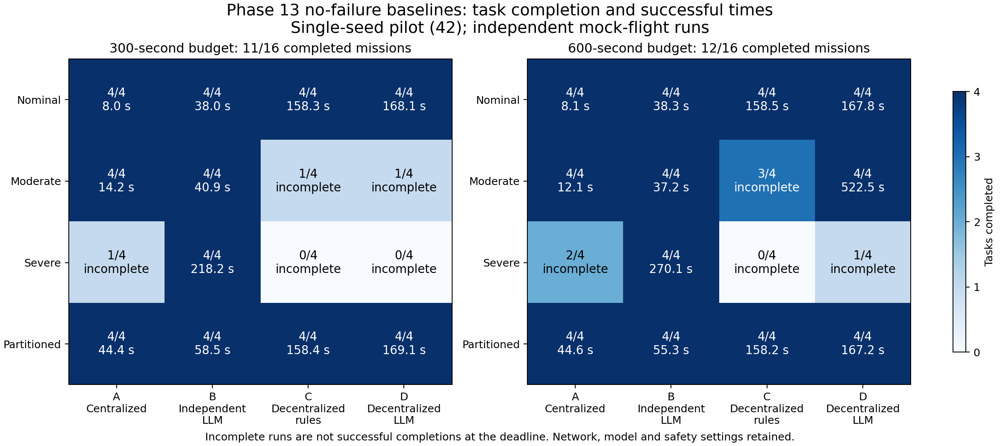
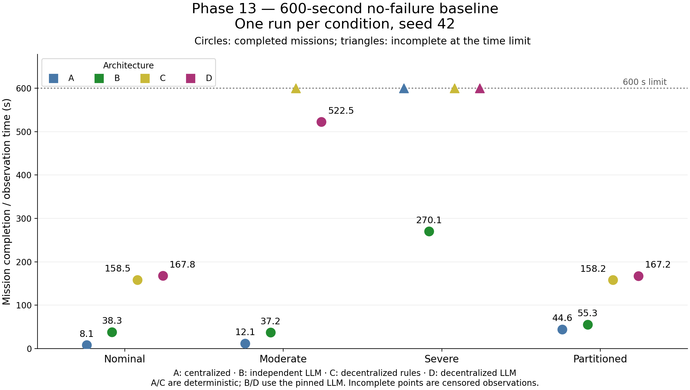

# Phase 13: 600-second results analysis

Reviewed repository commit `406094d857cb4b48de8aa2c03f57c1051c2da996`, dataset `results/phase13/duration_600s_run1/budget_600s`. Comparison dataset: `results/phase13/automated_pinned_run1`. This review does not modify the experiments or results.

## Coverage and validity

All 40 planned case IDs have completed status, a summary, waypoint arrivals, scenario events and passing validation. There are no runtime errors, validation failures, duplicate task completions or mismatched-input checks. Twenty-one runs used Ollama; all experiments used mock flight and seed 42. The pinned-model suite does not perform the validation profile's exact packet-replay check.

I cross-checked all 40 per-case summaries against aggregate task counts, both waypoint indices for every completed task, validation records, and actual failure injections. These consistency checks passed. Guardian coverage is reported by each existing runner validation; this review did not independently re-audit every archived dispatch.

## Mission outcomes

| Measure | 300 s pilot | 600 s follow-up |
|---|---:|---:|
| Tests finished | 40/40 | 40/40 |
| Full mission success | 15/40 | 15/40 |
| No-failure baseline mission success | 11/16 | 12/16 |
| Observed failure injections | 20 | 21 |
| Full mission success after an observed failure | 0 | 0 |

The unchanged overall count hides one gained success and one loss of an earlier unevaluable failure-labelled success. Moderate D changes from incomplete to complete. Nominal A with Drone1 failure previously finished at 7.9 s before the planned 8 s injection; it now observes the injection, completes three sectors and leaves one unfinished. The latter is a newly exercised recovery test, not evidence that increasing duration made nominal control inherently worse.

## Baselines without intentional drone failure

| Condition | A centralized | B independent LLM | C decentralized rules | D decentralized LLM |
|---|---|---|---|---|
| Nominal | 4/4, 8.1 s | 4/4, 38.3 s | 4/4, 158.5 s | 4/4, 167.8 s |
| Moderate | 4/4, 12.1 s | 4/4, 37.2 s | 3/4, incomplete | 4/4, 522.5 s |
| Severe | 2/4, incomplete | 4/4, 270.1 s | 0/4, incomplete | 1/4, incomplete |
| Partitioned | 4/4, 44.6 s | 4/4, 55.3 s | 4/4, 158.2 s | 4/4, 167.2 s |

Incomplete cases were observed to approximately 599.9 s. Their completion time remains censored; 600 s is not a successful completion time.

Compared with the pilot, moderate C improves from 1/4 to 3/4; severe A from 1/4 to 2/4; severe D from 0/4 to 1/4. Severe C remains at 0/4. B succeeds in all four no-failure conditions but cannot cooperatively reassign a permanently failed worker's fixed task by design.

Moderate D has all eight expected recorded arrivals, one completed sector per drone, zero duplicates, guarded dispatch, and productive LLM decisions from all four agents. Its completion times by sector are B 145.8 s, D 194.8 s, C 358.8 s, A 522.5 s. A completes at task version 3 and C at version 2, with three lease expirations reported. This is evidence of eventual execution after ownership epochs expired, not intentional teammate-failure recovery. There are no actor-silencing events in this case.

The model identity remains `phase12-agent:pinned`, digest `46e0c10c039e019119339687c3c1757cc81b9da49709a3b3924863ba87ca666e`, temperature 0. For the inspected moderate-D manifests, the effective configurations differ only in ticks and output directory; the added follow-up module is the only additional/changed source-hash entry. These are independent wall-clock runs, not continuations with identical model responses or packet traces. Budget-dependent contexts/leases and scheduling variability mean the comparison does not isolate duration as the sole cause.

## Remaining blockers and ablations

Every observed failure scenario remains incomplete, with stale_or_future_peer_belief repeatedly recorded. Silence is not evidence that a physical drone has disappeared; deleting it from safety checks would not be a valid recovery fix. Task reassignment must be paired with safe execution under peer uncertainty.

Role-bearing C and the deterministic replacement each change one role but complete no task. D performs no role change in its relay-failure control and also remains incomplete. This does not establish successful relay replacement or RF connectivity restoration.

Memory-off nominal D finishes in 167.8 s, effectively the same observed time as the memory-on control. Deterministic replacement finishes in 158.3 s, faster than nominal D's 167.8 s. Perfect-communication D finishes all tasks at 168.9 s compared with only 1/4 under severe networking. No-lease and no-role failure ablations remain incomplete. These single paired observations do not demonstrate an LLM or memory advantage; the network override jointly changes several network properties.

## Phase 13 exit criterion

The stated exit criterion is that A/B/C/D can be selected through configuration using shared mission, skills, scenario, network and guardian infrastructure. The suite provides evidence that this engineering criterion works: all four architectures ran through the common runner and the matching checks passed. It does not require all degraded/failure missions to succeed, nor does it establish that D outperforms A/B/C.

A defensible conclusion is: the configuration-based architecture comparison is operational, and the longer pilot demonstrates eventual agentic task completion under moderate communication degradation; severe-loss completion and actual teammate-failure recovery remain unresolved.

Next priorities are reliable assignment acknowledgments/retries, safe handling of unreachable peers, and correctly timed failure/outage trials followed by matched multi-seed comparisons. A 1,200 s run could measure further progress in the no-failure severe cases, but extra time alone is not supported as a fix for the persistent failure-case stops. Preserve all incomplete outcomes.

## Figure

[Download the PDF figure](../results/phase13/duration_600s_run1/baseline_300_vs_600.pdf)

The figure shows no-failure baseline outcomes only. It does not hide incomplete failure/ablation cases; those are counted in the overall table above. PNG and PDF are included.

## Completion-time scatter plot

Circles mark completed missions; triangles mark incomplete observations at the 600-second limit. This panel uses the same four no-failure conditions as the baseline comparison.

[Download PDF](../results/phase13/duration_600s_run1/baseline_completion_times_600s.pdf)
