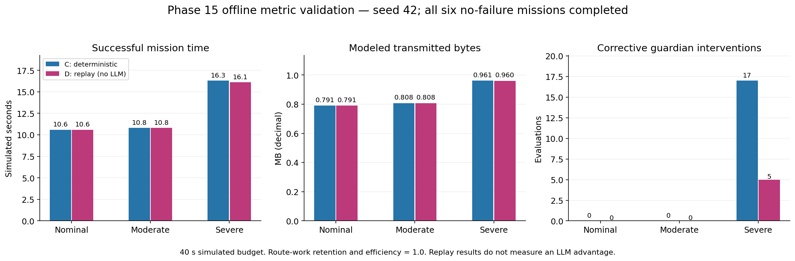
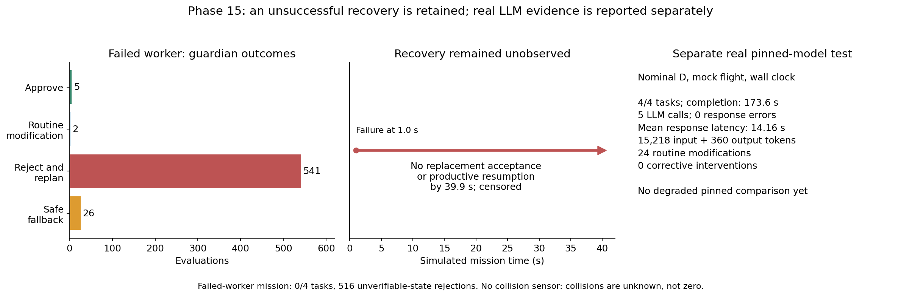

# Phase 15 evaluation results

## Assessment

The uploaded batches validate Phase 15's metric collection, pre-run registration, evaluation and missing-data handling for the current mock route benchmark. All eight uploaded per-experiment metric records were independently recomputed from their raw evidence and matched exactly. Both evaluation summaries report `prespecified: true` and zero evidence issues. The 22 focused Phase 15 tests also pass, including hand-calculated checks for every primary metric.

This satisfies the metric-definition and tested-implementation exit criterion within the documented scope. It does not demonstrate successful failure recovery or live-flight safety, and the replay tests do not demonstrate an LLM advantage.

Reviewed snapshot: [e5dd20ef1f497c6f00a863766ace169808cf715f](https://github.com/AkbasLab/carla_demo/tree/e5dd20ef1f497c6f00a863766ace169808cf715f/results/phase15). Definitions: [Phase 15 metric contract](phase15_evaluation_metrics.md).

## Evidence and registration

- [combined_offline_run1](../results/phase15/combined_offline_run1): seven experiments, 40 simulated seconds per experiment, seed 42. Six missions completed; the failed-worker mission timed out. No real LLM inference occurred.
- [pinned_logging_metrics_run1](../results/phase15/pinned_logging_metrics_run1): one nominal D experiment with actual Ollama inference, mock flight and a 600-second wall-clock budget. The mission completed.
- Both batches retain metric definitions, numeric contract, registration timestamp, evaluator hash, raw run evidence, CSV and JSON evaluations.
- Registration precedes experiment start and the saved contract, definitions and evaluator hashes match. Independent re-evaluation retained `prespecified: true` and zero evidence issues.
- Evaluator SHA256: `90c96d19d9d8b13391d66138dc53ce30b5461b68352b36dc79f2632a11821a92`.

## Offline no-failure comparisons

[Download PDF](../results/phase15/results_analysis/offline_metrics.pdf).

| Architecture / policy | Condition | Tasks completed | Successful time (simulated s) | Continuity retention | Modeled transmitted bytes | Corrective guardian interventions |
|---|---|---:|---:|---:|---:|---:|
| C: deterministic | Nominal | 4/4 | 10.6 | 1.0 | 791,169 | 0 |
| C: deterministic | Moderate | 4/4 | 10.8 | 1.0 | 807,690 | 0 |
| C: deterministic | Severe | 4/4 | 16.3 | 1.0 | 961,122 | 17 |
| D: replay, no LLM | Nominal | 4/4 | 10.6 | 1.0 | 791,169 | 0 |
| D: replay, no LLM | Moderate | 4/4 | 10.8 | 1.0 | 807,690 | 0 |
| D: replay, no LLM | Severe | 4/4 | 16.1 | 1.0 | 960,312 | 5 |

Severe networking increases observed completion time by approximately 54% for C and 52% for replay D relative to their nominal runs. Modeled transmitted bytes increase by approximately 21%. Binary continuity remains 1.0 because all required work completes; this metric does not express the additional delay or communication cost. All six runs record eight unique required waypoint arrivals, no repeated waypoint work, and route-work coordination efficiency of 1.0.

These are single-seed functional tests. Replay D has zero LLM calls and cannot support a claim that LLM reasoning improves severe-network performance. The close C/D outcomes are not a statistically established architectural ranking.

## Failure recovery and actual pinned inference

[Download PDF](../results/phase15/results_analysis/recovery_and_pinned.pdf).

### Failed worker

`failed_worker_rules` injects Drone1 failure at 1.0 simulated second, when it owns `SEARCH_SECTOR_A`. No replacement local ownership acceptance or productive waypoint resumption is observed by 39.9 seconds. Recovery time is therefore null and censored, not zero. The mission completes 0/4 tasks; successful completion time is null, with a 40-second budget and 39.9-second observation endpoint.

The logs record 574 guardian evaluations: 5 approvals, 2 routine modifications, 541 rejections and 26 safe fallbacks. Of the rejections, 516 concern unverifiable state. The 26 fallbacks are `HOLD_POSITION`; there are no emergency landing/return fallbacks. Four tasks are orphaned at the endpoint, and sampled movement distance is zero. This exposes unresolved execution under peer uncertainty rather than demonstrating recovered mission capability. Silence must not be treated as evidence that the failed drone has physically disappeared.

Communication records include 778 unique sends and 741 pending recipient records at stop. Pending messages are not silently treated as delivered or lost. Messages per completed task is null because no task completed. Continuity retention is unavailable because this fault-matched nominal-network reference itself has a zero score; the unrelated no-failure nominal result is not substituted.

### Pinned-model test

The separate nominal D run completes all four tasks in **173.6 wall-clock mission seconds**, with zero duplicate task completions. Five LLM calls have complete provider usage: **15,218 input tokens and 360 output tokens**. Mean observed response latency is **14.16 seconds**, with a 15.07-second p95 and no response errors or fallback-policy invocations.

The verified model is `phase12-agent:pinned`, digest `46e0c10c039e019119339687c3c1757cc81b9da49709a3b3924863ba87ca666e`. All dispatched effects are guardian-verified. There are 24 routine bounded-segment modifications, zero corrective guardian interventions and zero unsafe-proposal evaluations. Route-work efficiency is 1.0. Communication overhead is 2,863 unique sends, 5,593,992 modeled transmitted bytes and 715.75 sends per completed task.

Its nominal continuity value of 1.0 is a self-reference, not evidence of robustness under degraded communications. No matched real-model degraded run exists in this batch. Do not compare its wall-clock time directly with accelerated offline simulated time. The Phase 14 pinned run's 175.3 seconds belongs to a different run and remains unchanged in that report.

## Primary-metric validation

| Metric | Evidence in these uploads | Scope |
|---|---|---|
| Mission completion | Seven successful missions and one unsuccessful mission; required waypoint and guarded-action evidence checked | Strict route-execution success, not searched area or safe return |
| Completion time | Successful times measured; failed-worker time null with endpoint and budget | Simulated and wall clocks reported separately |
| Continuity retention | Matched C/replay-D degraded references produce 1.0; zero-score reference produces null | Single seed; no real-model degraded comparison |
| Recovery time | Fault-onset ownership captured; unobserved replacement and work resumption censored | Positive recovery not demonstrated; calculation is covered by focused tests |
| Safety | Sampled separation/restricted-zone metrics, unsafe proposals, fallbacks and guardian outcomes | Collision observations absent; no physical safety certification |
| Communication overhead | Unique sends, recipient attempts, bytes, retries, duplicate deliveries, expiration and pending records | Modeled application transport, not measured RF throughput |

All eight runs record zero sampled separation violations, with a minimum sampled separation of 8 m against a 2 m threshold. Collision counts remain null because collision observations were not collected. Area coverage, verified target detection, safe-return fraction and calibrated energy in joules are also unavailable. Their null values are correct missing-data handling, not evidence of zero hazards or successful sensing.

## Research interpretation and remaining work

These results establish that predefined metrics can be computed consistently from automated experiment evidence, including successful missions, timeouts, missing sensors and actual local-model inference. They do not establish successful failed-worker recovery, relay restoration, repeated-trial reliability, live CARLA–AirSim execution, or an LLM performance advantage.

Before main benchmarking, resolve the failed-worker safety/execution blockage, add matched degraded pinned-model runs over multiple seeds, and add genuine area/target/return observations only if the paper intends to claim those capabilities. Keep the registered definitions fixed; any changes require an explicitly versioned contract.
