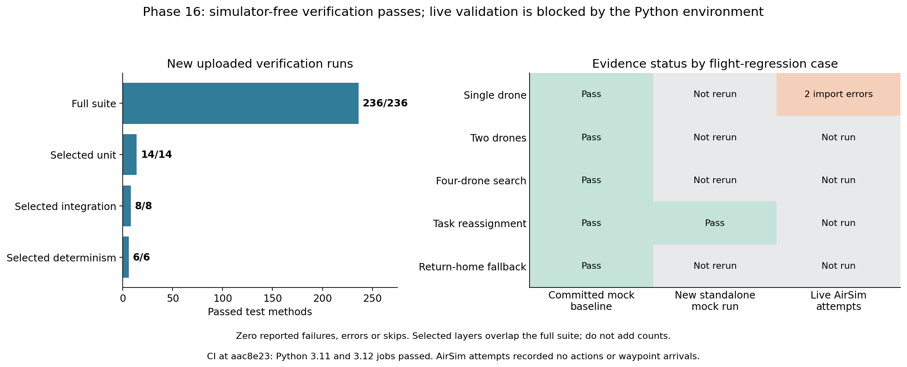
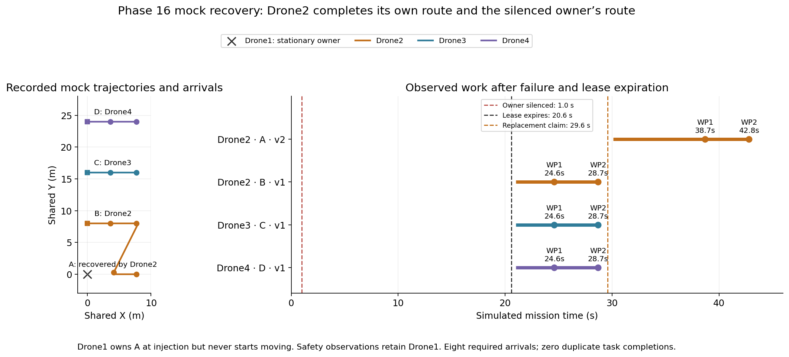

# Phase 16 verification results

## Assessment

The new uploads confirm that the simulator-free verification suite passes on the tested source revision. The standalone mock failure scenario also confirms task takeover and observed route completion. Hosted CI passed on Python 3.11 and 3.12 for the implementation commit.

**Live AirSim regression validation remains incomplete.** Both uploaded single-drone attempts stopped at Python import with `ModuleNotFoundError: No module named 'airsim'`. They contain no executed actions or waypoint arrivals, so they provide neither a live flight pass nor evidence of a flight-control failure.

Reviewed result snapshot: [f864ac0967bca99d55b181c6295cdb1c37a711c2](https://github.com/AkbasLab/carla_demo/tree/f864ac0967bca99d55b181c6295cdb1c37a711c2/results/phase16). The uploaded verification summaries identify implementation commit `aac8e234558f66b8b2db2859543939b3e7838d1a` and Python 3.12.13. See the [Phase 16 implementation and commands](phase16_verification.md).

## Verification results



[Download PDF](../results/phase16/results_analysis/verification_dashboard.pdf).

| Uploaded run | Test methods passed | Failures / errors / skips | Elapsed verification time |
|---|---:|---|---:|
| [verification_run2](../results/phase16/verification_run2) | 236/236 | 0 / 0 / 0 | 90.34 s |
| [unit_run1](../results/phase16/unit_run1) | 14/14 | 0 / 0 / 0 | 3.95 s |
| [integration_run1](../results/phase16/integration_run1) | 8/8 | 0 / 0 / 0 | 2.25 s |
| [determinism_run1](../results/phase16/determinism_run1) | 6/6 | 0 / 0 / 0 | 32.37 s |

These elapsed values describe software-test execution, not drone mission completion. The selected-layer runs repeat tests contained in the full suite and overlap one another. They are not 264 independent tests or experimental trials. The requirement map references 27 unique test methods across 12 unit topics, seven integration topics and three determinism topics; the full suite covers additional rules and edge cases.

The full run reports every mapped topic passed. Layer-only summaries correctly leave unselected tests as `not_run`, except where a test is shared between selected and unselected topics. No source change is reported during any of the four runs. All 119 recorded source hashes in each summary match the reviewed local implementation files.

Unit coverage includes task cost, tie breaking, lease expiry, serialization, TTL, packet-loss sampling, latency scheduling, role changes, belief aging, geofence, battery reserve and invalid policy output. Integration includes two/four-agent allocation, takeover, partition isolation, delayed claim correction, relay replacement and malformed-output fallback. Determinism includes seeded network events, configured targets/faults and repeated deterministic execution across process hash seeds. These checks use deterministic policies or fixed/replayed model outputs; they do not establish reproducibility of actual LLM sampling or server scheduling.

## Standalone mock task takeover



[Download PDF](../results/phase16/results_analysis/mock_reassignment.pdf).

The new [mock_reassignment_run1](../results/phase16/mock_reassignment_run1) provides the following event sequence, measured on its simulated mission clock:

| Event | Time |
|---|---:|
| Drone1 claims Sector A, version 1 | 0.5 s |
| Drone1 is silenced while owning A | 1.0 s |
| Surviving agents observe the expired A lease | 20.6 s |
| Drone2/3/4 start their own B/C/D routes | 21.0 s |
| Drone2/3/4 record the final B/C/D waypoint | 28.7 s |
| Drone2 issues the replacement A claim, version 2 | 29.6 s |
| Drone2 starts executing recovered route A | 30.1 s |
| Drone2 records A's first waypoint | 38.7 s |
| Drone2 records A's final waypoint | 42.8 s |
| Final telemetry observation after commands settle | 43.1 s |

Drone2 completes both Sector B and Sector A; Drone3 completes C and Drone4 completes D. The evidence contains all eight required waypoint indices, four unique task completions, and zero duplicate task completions. All eight movement effects match guardian-approved command IDs. Arrival errors are within the configured 0.4 m horizontal and 0.6 m vertical tolerances; the largest recorded horizontal error is approximately 0.4 m.

The stopped actor remains in every relevant guardian peer observation. Its recorded position stays `[0, 0, -3]`; it is not removed from separation checks. The minimum separation across sampled telemetry is 4.0 m. This is sampled kinematic evidence, not collision-sensor output or a guarantee about physical flight.

Two qualifications matter:

1. Drone1 never starts a movement command before injection. It is an airborne, stationary task owner when silenced. This demonstrates recovery of owned unfinished work, but not interruption midway through a route or takeover of a partially flown route.
2. Movement begins at 21.0 s, well after the 1.0 s fault. The 20-second lease/peer-aging and acknowledgment rules delay execution in this harness. The run demonstrates eventual recovery, not instantaneous takeover or an LLM inference delay. The replacement-claim, execution-start and first-arrival timestamps are distinct observations and must not be conflated into one recovery-time definition.

The eight behavioral JSON files in this new standalone run are byte-identical to the corresponding committed mock reassignment baseline; manifest timestamps differ. This supports repeatability for this scenario, not a broad statistical recovery-success estimate.

This regression uses perfect communication and an infrastructure safety observer with telemetry from all configured drones. It therefore does **not** resolve or replace the degraded local-belief recovery failure reported in [Phase 15](phase15_results.md).

## Live AirSim attempts

| Run | Recorded outcome | Executed actions | Recorded arrivals |
|---|---|---:|---:|
| [airsim_single_run1](../results/phase16/airsim_single_run1) | Environment error: missing Python `airsim` module | 0 | 0 |
| [airsim_single_run2](../results/phase16/airsim_single_run2) | Same environment error | 0 | 0 |

Both manifests correctly retain `status: error`, and both summaries retain `passed: false` and `mission_complete: false`. Their telemetry, message, action, guardian and arrival arrays are empty. The failure occurs before the AirSim adapter connects or acquires vehicle control. Empty cleanup warnings are expected in this case and do not establish a safe flight or landing.

The immediate next step is to activate the Python environment containing the working AirSim client, or install the compatible client and dependencies into the interpreter used for the regression command. Check that exact interpreter before rerunning:

```bash
python -c "import sys, airsim; print(sys.executable); print(airsim.__file__)"
```

After this succeeds, use the same calibrated live mission configuration and a fresh output directory, following the [manual AirSim commands](phase16_verification.md#manual-airsim-execution). Keep the two failed attempts. A working module import alone is not simulator connectivity or successful flight evidence.

Single-drone flight must first be verified, followed by the two-drone, four-drone, in-flight reassignment and return-home cases. None of those five live case types has a successful uploaded outcome yet.

## Continuous integration evidence

[GitHub Actions run 42158452901](https://github.com/AkbasLab/carla_demo/actions/runs/42158452901), on implementation commit `aac8e23`, completed successfully. Both `mock-verification (3.11)` and `mock-verification (3.12)` passed dependency installation, the verification command and evidence upload. This independently demonstrates that the simulator-free workflow executes on hosted runners, rather than merely being configured in YAML.

The newer results-upload commit triggered a separate workflow. Its status is time-dependent; see [GitHub Actions](https://github.com/AkbasLab/carla_demo/actions). The completed implementation workflow above is the stable CI evidence used in this report.

## Audit and evidence limits

All 79 reviewed Phase 16 files were fetched from the fixed result snapshot and checked against their Git blob hashes. Summary counts were checked against individual test records, and requirement-map statuses were checked against the referenced test IDs. The mock takeover was checked against allocation events, arrivals, telemetry and guardian/adapter command IDs. Machine-readable findings are in [audit_results.json](../results/phase16/results_analysis/audit_results.json), with a [CI snapshot](../results/phase16/results_analysis/ci_snapshot.json).

The new full and selected-layer uploads contain `summary.json` but do not include their generated `unittest.log` files. Individual test IDs/statuses are present, so the outcome counts can be checked, but full console diagnostics from those specific reruns are not available in the repository. Upload those logs or retain the CI artifacts for diagnosis. The older `verification_run1/unittest.log` is not substituted for the newer runs.

The figures distinguish earlier committed mock baselines, the new standalone mock rerun and actual live attempts. They do not count unit-test successes as successful live missions, assume missing collision measurements are zero, or claim an LLM/architecture performance advantage.

## Phase 16 conclusion

The results support the exit criterion that coordination and communication defects can be tested without launching CARLAAir: the full simulator-free suite passes, mapped integration and determinism checks pass, and hosted CI passes on two Python versions. The separate live-regression requirement remains pending because the uploaded attempts were blocked before flight.

For the paper: “The verification suite passed all 236 simulator-free tests and executed successfully in continuous integration on Python 3.11 and 3.12; a repeated mock fault scenario confirmed lease-based task takeover without deleting the stopped vehicle from safety observations, while live AirSim validation remained pending due to a missing client dependency.”
