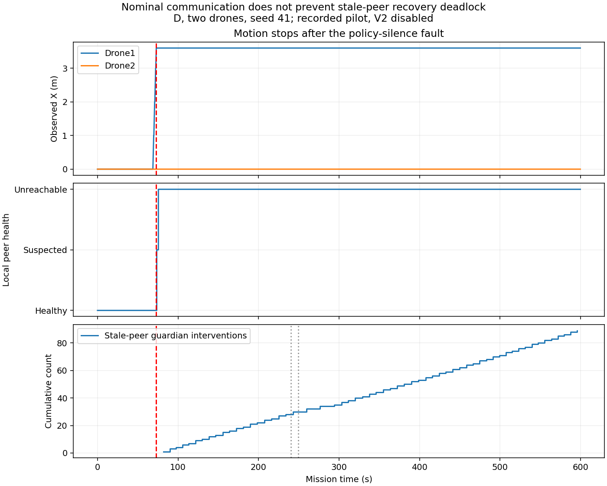

# Phase 17 calibration evidence repair

This reconciliation uses the data uploaded in commit `7b5d3dad99f820cf9606f89ab8a9ccc2e1a7bb27`. It changes evidence organization and derived reports; it does not change the mission, prompts, safety guardian, model, network, failure time, or runtime implementation. No additional mission was run.

## Cohort status

| Status | Cases |
|---|---:|
| Planned | 48 |
| Finished with complete compatible evidence | 20 |
| Successful missions among those finished cases | 5 |
| Finished unsuccessful missions | 15 |
| Interrupted attempt needing replacement | 1 |
| Never-started cases | 27 |
| Cases still needing execution | 28 |

The metrics evaluator also includes the interrupted attempt, so its output contains **21 evaluated attempts, five successes and 16 censored missions**. This does not mean 21 finished cases. Missing cases have no fabricated metrics or runtime manifests.

The completed seed-41 cases cover all 16 architecture/team/network/fault combinations. Seed 42 has four finished C/two-drone cases; its C/four-drone nominal control was interrupted. All seed-43 cases remain missing.

## Preservation and selection

The primary cohort uses the **earliest available finished attempt with complete, compatible evidence**, regardless of mission outcome. A finished timeout is retained; it is not replaced by a later attempt because that later outcome is better. Technical preflight errors and interrupted attempts remain in the attempt record but do not substitute for a completed run.

- `D_n2_nominal_control_s41` moved from the pilot root to `runs/D_n2_nominal_control_s41`.
- `D_n2_severe_loss_s41` moved out of `runs/D_n2_severe_control_s41/` into its own sibling directory under `runs/`.
- The four original Ollama warmup failures were restored from commit `886c2213952b074d419d66ec636a57b78ed967c9` under `attempts/original_warmup_failures/`.
- The original interrupted batch manifest, metrics and calibration analysis are retained under `attempts/before_consolidation/`.
- Later nominal-fault and severe-control attempts remain under `results/phase17/main_calibration_repair2/`. They are indexed as separate attempts, not silently substituted.
- The interrupted `C_n4_nominal_control_s42` remains in place until a separately recorded replacement is available.

`results/phase17/main_calibration_run1/consolidation.json` records attempt IDs, original locations, selected manifests/summary hashes, the selection rule, original pre-run registrations, and pending batches. Raw per-run manifests and logs were not rewritten; their original output-directory strings are historical provenance.

Every selected finished case has the same recorded runtime source hashes and requested case configuration as the original cohort. Different Git commit IDs reflect intervening result/document uploads; they are not evidence of a runtime source change here.

The merged runs have different genuine pre-run registration timestamps. The reconciliation verifies each attempt's original registration against the unchanged evaluator, metric contract and definitions, and verifies that registration precedes that attempt. It does not create or backdate a replacement registration. The consolidated evaluation is labeled `recomputed_from_individual_pre_run_registrations`.

## Why the nominal fault run still fails

Selected case: `D_n2_nominal_loss_s41`, beginning at 18:58 UTC on November 7, 2026. Communication has no intentional loss. The configured policy-process fault occurs at 73 seconds; this cohort has `pilot_resilience_v2.enabled: false`.

| Recorded stage | Mission time |
|---|---:|
| Drone1 begins executing Sector A | 69.0 s |
| Drone1 is silenced while moving, owning Sector A | 73.0 s |
| Drone2 first records Drone1 as SUSPECTED | 73.6 s |
| Drone2 first records Drone1 as UNREACHABLE | 75.6 s |
| First post-fault stale-peer guardian rejection | 81.8 s |
| Drone2's own Sector B lease expires and is reannounced | 240.4 s |
| Failed Drone1's Sector A lease expires and is reannounced | 249.2 s |
| Observation ends without a replacement acceptance | 599.8 s |

The trace supports failure detection, lease expiration and reannouncement. **It does not support a feasible replacement bid, replacement acceptance, guarded recovery motion, or waypoint arrival.** Drone1 stops at approximately `(3.60, 0, -3)`; Drone2 stays at `(0, 8, -3)`. No waypoint arrival is recorded.

The cause is a recovery/uncertainty deadlock, not simply an unavailable model:

1. Silencing the policy also stops its normal state reports. This older configuration has no enabled independent telemetry path for the silent actor.
2. Drone2 retains Drone1 as a physical peer, with an increasingly old position/velocity report. Correctly, silence does not delete the physical drone.
3. `RuntimeGuardian._state_errors` rejects stale peer state before action-specific checks. This affects proposed HOLD actions as well as movement.
4. `PersistentAgent._bid_available` requires a valid safety state. Once the peer record becomes stale, Drone2 cannot submit a feasible recovery bid, even after task reannouncement.
5. The selected trace contains **89 post-fault guardian interventions with `stale_or_future_peer_belief`**. Repeated decisions/fallback attempts do not refresh the missing peer state.

There were 65 LLM calls; recorded mean response latency was 8.32 s and P95 9.03 s. One response error occurred. Thus the model did run, but repeated reasoning did not repair the missing safety-state prerequisite. Increasing the duration alone does not address this mechanism.



The JSON alongside this figure includes source artifact hashes and the traced milestones. Reproduce the diagnosis with:

```bash
python scripts/analyze_phase17_nominal_failure.py \
  --run-dir results/phase17/main_calibration_run1/runs/D_n2_nominal_loss_s41 \
  --output-dir /tmp/phase17_nominal_diagnosis
```

## Next execution: small batches, not the full matrix

Fourteen configuration files under `results/phase17/main_calibration_run1/pending_batches/` contain **only the 28 genuinely missing/interrupted cases**, two cases per file. They copy original entries without changing the 600-second budget, model pin, seed, or failure scenario. The first batch is the interrupted C/four-drone nominal control and its missing fault counterpart, seed 42.

Run one batch, inspect it, and then decide whether to continue:

```bash
python -u scripts/run_phase14_experiments.py \
  --batch results/phase17/main_calibration_run1/pending_batches/batch_01.json \
  --output-dir results/phase17/main_calibration_pending_run1/batch_01 \
  --evaluate
```

The output folder above is a **new** execution folder; it is not claimed to exist. Use a fresh folder if it already exists. No automatic loop was added to launch all 14 batches. Keep Ollama available for D cases; this cohort uses mock flight and does not require CARLA-Air.

These batches complete the **old declared cohort**. They do not enable V2 or fix its recovery design. Given the nominal-fault diagnosis, it is reasonable to pause further D fault runs until a separately declared V2 development/validation check demonstrates replacement acceptance and productive resumption. If runtime rules, telemetry semantics or fault design change, use a new cohort and retain this one as comparison evidence.

## Freeze remains blocked

The regenerated legacy calibration report correctly remains ineligible. Besides missing runs, the observed severe controls all fail, and two observed D severe fault cases did not interrupt an active MOVE. These are methodological blockers, not file-copy problems.

The legacy analyzer also produces derivative flags such as `implementation_changed_across_pilots`, `actual_llm_calls_missing`, `model_identity_not_consistent` and an artificially low nominal reference rate when it compares missing-case placeholders to actual observations. Those flags must not be interpreted as proof that the 20 finished cases changed source or lacked a pinned model. The attempt index establishes source compatibility for the selected finished cases; missing cases still block freeze. The analyzer and its eligibility checks were deliberately not relaxed to force acceptance.

Do not run Phase 18 held-out experiments or force a calibration lock from this dataset yet.

## Verification

Five reconciliation tests cover earliest-attempt selection, preservation of unsuccessful outcomes, source/configuration mismatches, technical failures and pre-run registration checks. A separate audit confirms that pending IDs are unique, exactly match the 28 missing cases, and exclude all 20 finished cases. Existing Phase 15 and Phase 17 regression tests are also run before publication.
