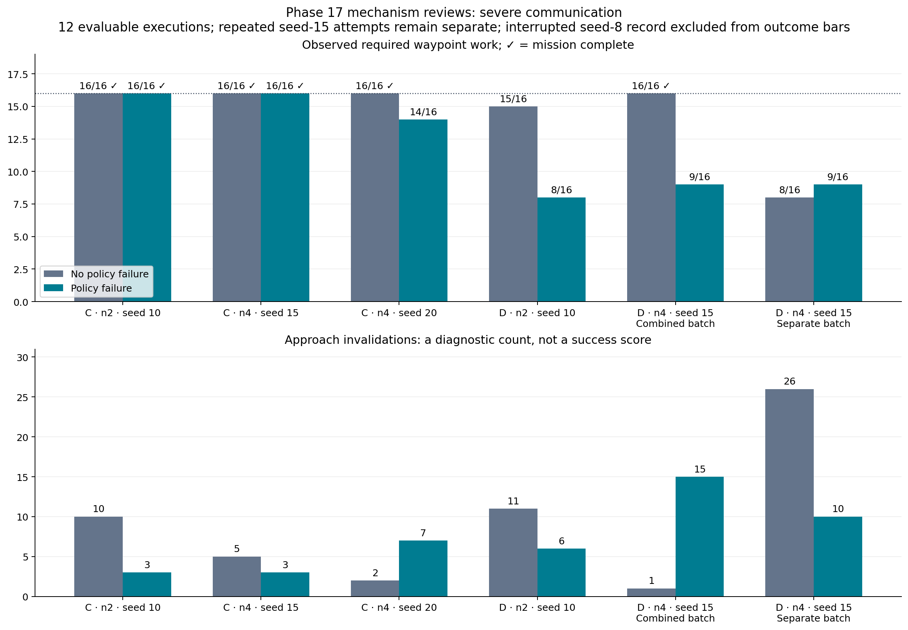
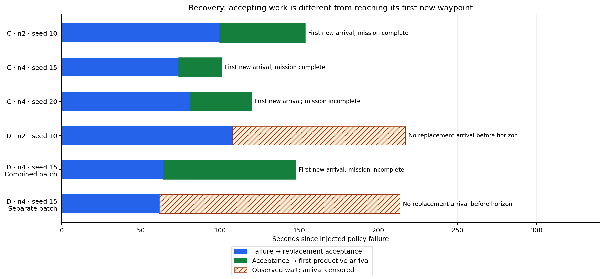

# Phase 17: summary of six mechanism-review folders

This review covers the diagnostic files uploaded in commit `ef15eaa`.
There are 13 records: 12 evaluable executions and one interrupted, incomplete
evidence record. The figures describe development observations, not final
architecture success probabilities or live-flight evidence.

## Check folder names before interpreting the data

- `severe_C_D_n2_s15` actually contains **four-drone** C and D cases at seed 15.
  The experiment IDs and original manifests establish the team size.
- `severe_C_n4_s8` contains only `A_n4_severe_control_s8`. Its original execution
  was interrupted by `KeyboardInterrupt`; summary, protocol, arrivals and guardian
  evidence are missing. It is not a completed C test and cannot supply a mission
  outcome. Preserve this record and diagnose/repeat the intended missing case in
  a new directory if needed.
- The D four-drone seed-15 cases in the combined folder and in `severe_D_n4_s15`
  are **distinct attempts**, not additional seeds. Their recorded source hashes
  and pinned model configuration match, but their outcomes differ. Retain both;
  do not silently replace the incomplete attempt with the successful control.

All 12 evaluable reviews report no missing artifacts or evidence-reading issues.
This establishes readable evidence, not successful missions.

## Mission work and task completion

Each mission requires four tasks and 16 distinct waypoint work units. Control
means no injected policy failure; communication is still severe.

| Architecture / team / seed | Control tasks; waypoints | Failure tasks; waypoints | Interpretation |
|---|---|---|---|
| C / 2 / 10 | 4/4; 16/16 | 4/4; 16/16 | Complete control and recovery |
| C / 4 / 15 | 4/4; 16/16 | 4/4; 16/16 | Complete control and recovery |
| C / 4 / 20 | 4/4; 16/16 | 3/4; 14/16 | Failed peer's task recovered; another task remains blocked |
| D / 2 / 10 | 3/4; 15/16 | 2/4; 8/16 | Near-complete control; replacement arrival unobserved |
| D / 4 / 15, combined batch | 4/4; 16/16 | 2/4; 9/16 | Successful control; productive recovery begins but mission remains incomplete |
| D / 4 / 15, separate batch | 2/4; 8/16 | 2/4; 9/16 | Control and recovery remain incomplete |

Across these selected records, C completes five of six missions and D one of
six. This is an uneven development collection, including a repeated D seed and
different team/seed combinations; these counts are not a balanced comparison
or a population success-rate estimate.



**Figure 1.** Required work and replanning activity. A check mark denotes mission
completion. Fewer invalidations are not inherently better: a working guardian
may need to invalidate a route, while many invalidations with no new work can
indicate unstable approaches. The interrupted seed-8 record is not shown as
zero completed work. The two D seed-15 attempts remain separate.

[PDF version](figures/phase17_mechanism_review/work_and_replanning.pdf).

## Productive recovery is distinct from task acceptance

| Failure case | Failure → acceptance | Acceptance → first new required arrival | Full mission complete? |
|---|---:|---:|---|
| C / 2 / 10 | 99.8 s | 54.0 s | Yes |
| C / 4 / 15 | 74.0 s | 27.2 s | Yes |
| C / 4 / 20 | 81.4 s | 38.8 s | No |
| D / 2 / 10 | 108.0 s | Not observed | No |
| D / 4 / 15, combined batch | 64.0 s | 83.8 s | No |
| D / 4 / 15, separate batch | 61.6 s | Not observed | No |

These intervals describe the first registered replacement-assignment episode,
with the same replacement agent and epoch. A missing arrival is censored at
the recorded horizon, not a zero-second recovery. Successful first arrival
does not establish completion of the replacement task or the team mission.



**Figure 2.** Blue is delay before replacement acceptance; green is subsequent
delay to the first productive arrival. Hatched bars show observed waiting with
no arrival, rather than an estimated recovery duration. Labels separately state
whether the entire mission completed.

[PDF version](figures/phase17_mechanism_review/recovery_intervals.pdf).

## Main remaining defects indicated by the diagnostics

**C has one pronounced task-churn case.** Four-drone seed-20 failure records 15
claim events and ten releases overall. Sector C accounts for 11 claims over ten
versions, ten releases and just two of its four required arrivals. It also
records 189 policy-error events and 72 policy fallback activations across the
mission. Sector A, which belonged to the deliberately stopped drone, does get
recovered. Another physically blocked task prevents full completion.

**D often accepts work without efficient execution.** The two-drone failure
accepts replacement work but records no productive arrival. In four-drone
seed-15 combined-batch failure, a replacement does reach a new waypoint after
83.8 s, but total work remains only nine of 16 waypoints. This shows productive
resumption can exist without full recovery.

**D's repeated seed-15 attempts expose variability.** The combined-batch control
finishes in 130.8 s with one local lease expiration and one approach invalidation.
The separate control times out with seven local lease-expiration events and 26
invalidations. It also records one `inference_timeout` policy event. The files do
not isolate the cause of the difference; model outputs, admission/scheduling and
wall-clock execution should be inspected before claiming strict reproducibility.
Matching source, model and seed do not by themselves establish identical runtime
conditions or packet traffic.

**Counting more leases or reports is not productive work.** A healthy process can
renew a lease while making guarded detour progress, yet still miss the next
mission waypoint. Track time and cumulative approach effort since the last new
required arrival, not only whether a lease is valid.

## Recommended next implementation work

1. Preserve blockage knowledge across assignment versions and refuse unchanged
   blocked approaches rather than repeatedly exchanging their task ownership.
2. Stabilize approaches under transient telemetry uncertainty. Replan on a
   meaningful physical change, while continuing to guard every live segment.
3. Bound approach effort without inventing progress. Use a validated help,
   yielding or release response when repeated motion produces no new required
   waypoint; never remove a silent aircraft from physical safety checks.
4. Investigate the contrasting D seed-15 traces, especially the seven lease
   expirations, timeout, model responses and admission waits. Do not attribute
   every incomplete D case to inference failure; several have no such event.
5. Correct future output-folder naming and retain unique attempt identifiers.
   The seed-8 interruption must remain visible separately from unfavorable but
   technically valid mission outcomes.

The strongest paired observation is the combined four-drone seed-15 batch:
both controls finish (C: 86.2 s; D: 130.8 s), while C also completes failure
recovery in 148.4 s and D does not. This supports further investigation of D's
execution overhead, but one pilot pair does not establish an LLM advantage or
a general architectural ranking.

## Evidence and reproduction

Source reviews are in `results/phase17/mechanism_review_v1/`:
`severe_C_D_n2_s15`, `severe_C_n2_s10`, `severe_C_n4_s20`, `severe_C_n4_s8`,
`severe_D_n2_s10`, and `severe_D_n4_s15`. Each `mechanisms.json` retains its source
result-directory and per-measurement artifact references. Original manifests in
`results/phase17/severe_recovery_v4_verified/` establish identity, code provenance,
model configuration and the interrupted seed-8 status.

Regenerate the figures without CARLA-Air or Ollama:

```bash
MPLCONFIGDIR=/tmp/phase17-mpl python scripts/plot_phase17_mechanism_review.py
```

The [figure source data](figures/phase17_mechanism_review/figure_sources.json)
preserves review-folder identity so identically named cases in different attempts
cannot silently merge. This report and its figures do not modify the original
evidence or change primary metric definitions.
