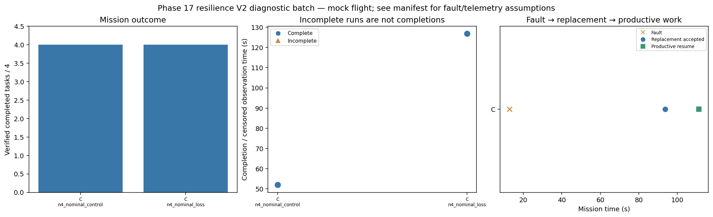

# Phase 17 resilience V2 — offline validation

The final simulator-free verification passed **269 tests**, with zero failures/errors and no source change during the verification run. Evidence is in `results/phase17/resilience_v2_software_verification_run2/summary.json`. Seven tests specifically cover the V2 stage sizes/seed protection, independent telemetry semantics, state-triggered fault eligibility, route-cost deadlines and battery/geometry checks, recovery plus lossless archive/metric restoration, fail-closed full silence, and model-preflight failure preservation.

These are offline development checks. **No pinned Ollama or live CARLA-Air result is claimed.** In the severe replay batch, C uses its deterministic policy and D uses a replay fixture, not actual LLM inference. See [the implementation guide](phase17_resilience_v2.md) for the changed scenario assumptions and pinned commands.

## Final small-batch observations

| Batch | Cases | Completed missions | Completion times (s) | Stored size, approximately |
| --- | ---: | ---: | --- | ---: |
| Four-drone nominal smoke, seed 7 | 2 | 2/2 | Control 52.0; policy-stop fault 126.8 | 2.17 MiB |
| Four-drone severe transport, replay, seed 8 | 4 | 4/4 | C/D control 56.8; C/D fault 151.2 | 5.31 MiB |
| Four-drone full-silence negative control, seed 7 | 2 | 1/2 | Control 51.8; fault censored at 239.8 | 2.07 MiB |
| Two-drone nominal smoke, seed 9 | 2 | 2/2 | Control 180.2; policy-stop fault 192.8 | 1.45 MiB |

Sizes include compressed raw evidence and generated figures. These are different small diagnostic sets, not a matched empirical estimate of how many bytes the full pinned batch will generate. They do demonstrate that complete diagnostic evidence can be retained far below the requested approximately 250 MB target. Runtime checks and raw model logs are not downsampled; original bytes are preserved in verified ZIP files.

The same four rectangular routes and original safety geometry are used. Shorter auction/lease settings and a 240-second horizon reduce waiting. The fault timing and surviving telemetry service are explicitly different from the original fixed-73-second full-agent-silence pilot. The favorable numbers therefore do **not** retroactively establish that the original 24 failed cases were fixed, nor do they isolate which modification explains an improvement.

## Recovery chain

In the four-drone nominal fault check:

- Drone1 is stopped at 12.8 s, while owning a task and actively moving.
- A surviving agent accepts the replacement task at 93.6 s.
- A new required waypoint is reached at 111.2 s.
- All four tasks complete at 126.8 s; Drone1 completes none and a survivor completes two.

Replacement acceptance latency is therefore **80.8 seconds** and productive-resumption latency **98.4 seconds** from fault onset. They are not zero-second recoveries. In the severe replay fault cases, onset is 13.2 s, replacement acceptance is 94.0 s and productive resumption is 129.8 s, with completion at 151.2 s.

All of these successful fault checks record the fault during owned movement, no sampled separation violations, and all dispatched actions passing through the guardian. The silent physical drone remains in peer state. Collision observations are unavailable; sampled checks are not certified collision avoidance.

## Negative control and remaining limits

When the independent telemetry service is also silenced, the fault mission remains incomplete, no replacement acceptance is observed, and the guardian continues to reject unverifiable motion. This check is essential: the positive result relies on an explicitly surviving telemetry component, not on removing the silent drone, inventing a fresh observation or relaxing safety distances.

Actual-model C/D testing should now use the four-case nominal stage first, inspect it, and only then launch a separate four-case severe stage. Several development seeds and both team sizes remain necessary before selecting final conditions. The replay severe batch's all-success outcome does not show that the severe profile is suitably calibrated for real model policies. Later in-sector failures and genuine radio outages also remain separate challenges.

Every V2 manifest keeps `eligible_for_final_freeze=false`. Passing `diagnostic_checks_passed` means only that this small batch demonstrated its intended mechanism, not that Phase 17 or Phase 18 is complete.

## Figures

[Four-drone nominal overview](../results/phase17/resilience_v2_smoke_run3/analysis/overview.png)

[Severe replay overview](../results/phase17/resilience_v2_severe_replay_run3/analysis/overview.png) · [Full-silence contrast](../results/phase17/resilience_v2_silence_run2/analysis/overview.png) · [Two-drone smoke overview](../results/phase17/resilience_v2_two_drone_smoke_run1/analysis/overview.png)

Each batch also retains individual nine-panel timelines and registered metric records under its `analysis` folder. Earlier development probes are separate folders and were not overwritten.

## Published evidence scope

The validation snapshots include compact summaries, registered metrics, configuration/provenance manifests, figures and the approved lossless ZIP evidence. ZIP contents include full event traces and available per-agent prompts, responses, request specifications and decision histories. These published checks use deterministic/replay policies, not actual pinned-model inference. Archive/member hashes are recorded in each case's `evidence_archives.json`. Use the restoration command in the guide when an older tool requires unpacked files.
