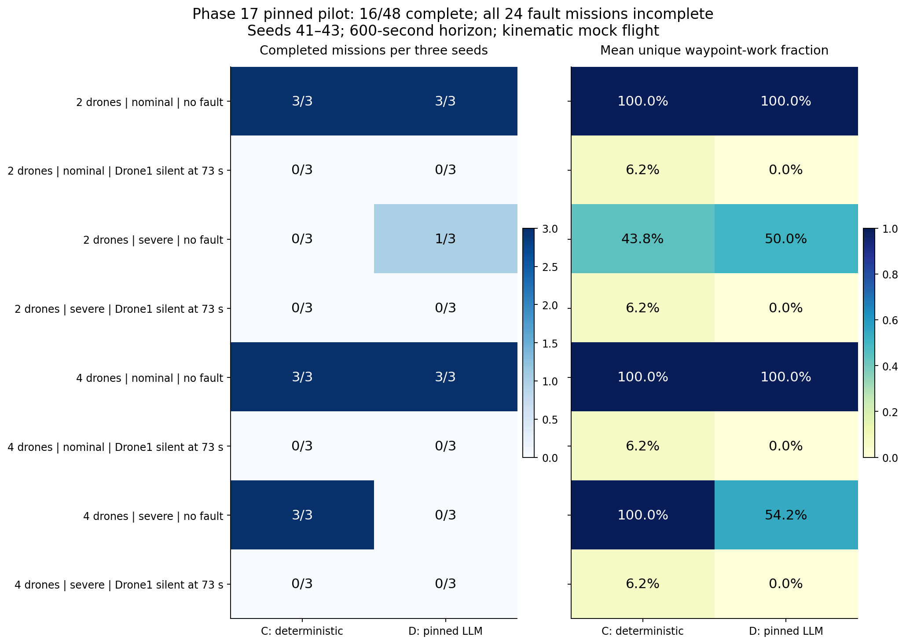
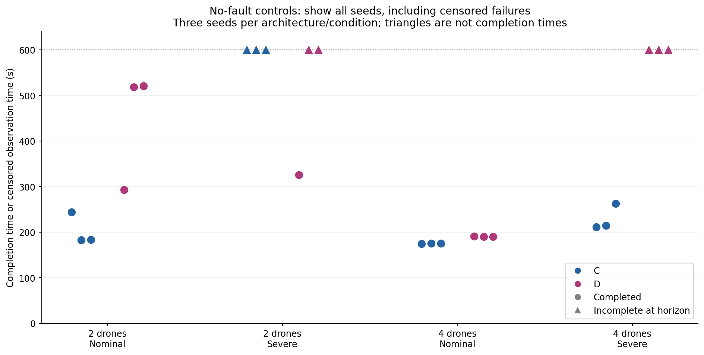
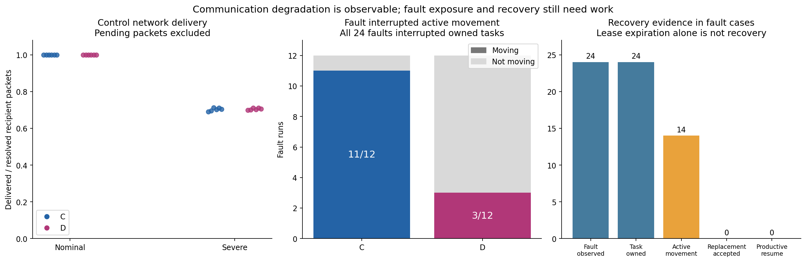

# Phase 17 results — pinned-model methodology pilot

**The batch completed, but Phase 17 is not ready for final configuration freezing.** All 48 experiments finished with no recorded runtime errors; 16 missions completed and 32 reached the horizon with unfinished work. Nominal no-fault operation is demonstrated in this mock benchmark. Successful recovery from the injected silent-agent fault is not demonstrated.

This review examines the results uploaded in [commit `cc0e371`](https://github.com/AkbasLab/carla_demo/commit/cc0e371dc716be4eb02b82926edf55494a71e5e7), under [`results/phase17/pinned_run1`](../results/phase17/pinned_run1). They are development/validation pilots, not held-out final comparisons.

## 1. What was tested

The matrix contains C (deterministic decentralized) and D (agentic decentralized), two/four drones, nominal/severe application communication, no fault/Drone1 silenced at 73 seconds, and seeds 41–43. There are 16 cells with three runs each: **48 experiments**. The maximum duration is 600 seconds, sampled at 0.2-second steps. The batch elapsed approximately **6 hours 29 minutes**.

All runs use the shared kinematic mock-flight backend, four search routes, 16 required waypoint work units, messaging and runtime guardian. These are not CARLA-Air flights or real-radio measurements. Silencing the actor stops its agent loop; it does not prove the physical vehicle has disappeared. Other agents must continue to account for uncertain peer occupancy.

Architecture D actually used Ollama: `phase12-agent:pinned`, digest `46e0c10c039e019119339687c3c1757cc81b9da49709a3b3924863ba87ca666e`, temperature 0, per-run seed, `num_predict=512`, `num_ctx=8192`; the recorded server version is 0.32.1. The reported source-hash sets are identical across all 48 runs. A sampled run manifest records implementation commit `f48b6046`; the later upload commit identifies the reviewed dataset, not a new implementation used during execution.

The metric evaluator reports 48 evaluated runs, predeclared definitions, zero evidence issues and zero missions that never started. For every run, this review separately cross-checked summary success, metric success, recorded unique waypoint units, successful time and fault-event presence. All checks passed. Selected raw policy histories and protocol logs were inspected for recovery diagnosis. This review did not independently reprocess all 2.48 GB of raw traces.

## 2. Mission outcomes

| Cohort | Completed / runs | Interpretation |
| --- | ---: | --- |
| Nominal, no fault | **12/12** | Usable nominal reference for both architectures and team sizes |
| Severe, no fault | **4/12** | Degradation affects mission completion; strong team/architecture interaction |
| Nominal, fault | **0/12** | Recovery not demonstrated even without intentional packet loss |
| Severe, fault | **0/12** | Recovery not demonstrated with additional communication degradation |
| All runs | **16/48** | 32 censored, incomplete outcomes; not execution crashes |



The right panel measures unique required waypoint work, not sensed area coverage. It exposes partial progress that a binary score hides. Every C fault run recorded only 1/16 waypoint units; every D fault run recorded 0/16. Zero recorded arrivals does not imply zero physical movement: the arrival tolerance might never have been reached.

### No-fault controls by team size

| Team | Network | C completed | C median successful time | D completed | D median successful time |
| --- | --- | ---: | ---: | ---: | ---: |
| 2 | Nominal | 3/3 | 183.6 s | 3/3 | 518.2 s |
| 2 | Severe | 0/3 | Not observed | 1/3 | 325.4 s, one success |
| 4 | Nominal | 3/3 | 175.0 s | 3/3 | 190.2 s |
| 4 | Severe | 3/3 | 214.8 s | 0/3 | Not observed |



Circles show successful completion; triangles show the observation horizon, approximately 599.8 seconds. Triangles are **not** 600-second successful completions. Successful-time medians exclude incomplete runs and should always be read with their completion counts.

D is slower than C in these nominal observations. The isolated two-drone severe success for D does not establish an LLM advantage: with four drones the observed pattern reverses. Three seeds per cell support pilot diagnosis, not a stable ranking, statistical superiority claim or an extrapolation to operational flight.

## 3. Communication calibration

| Configuration | Nominal | Severe |
| --- | ---: | ---: |
| Configured independent loss | 0% | 30% |
| Configured latency mean ± uniform half-width | 10 ± 2 ms | 400 ± 200 ms |
| Sender recipient-packet limit | Unlimited | 60/s |
| Sender egress budget | Unlimited | 50,000 bytes/s |
| Mean resolved delivery fraction, no-fault runs | 100.0% | 70.38% |
| No-fault mission completion | 12/12 | 4/12 |

Delivery fractions are equal-weight means across runs, not a single pooled packet-loss estimate. Pending packets are excluded from the resolved denominator. Expiration, queueing, recipient polling and other transport rules also affect outcomes. The measured application send-to-inbox delay must not be presented as RF latency: in no-fault controls, its run-mean average is approximately 0.527 s for C nominal, 0.449 s for D nominal, 0.772 s for C severe and 0.718 s for D severe.

The two levels are observably distinguishable, and severe communication remains useful in at least some cases. However, the aggregate 4/12 success rate hides nearly degenerate individual cells: C/four drones succeeds 3/3; C/two drones and D/four drones fail 0/3; D/two drones succeeds 1/3. Inspect those mechanisms before accepting the level as a fair architecture comparison. These parameters are an application-network scenario, not a calibrated radio model.



## 4. Failure recovery: what did and did not happen

All **24/24** injected faults were observed. Drone1 owned `SEARCH_SECTOR_A` at fault onset in **24/24** cases. Only **14/24** faults interrupted an active MOVE skill:

| Architecture | Fault observed | Task owned | Active movement interrupted | Replacement accepted | Productive resumption |
| --- | ---: | ---: | ---: | ---: | ---: |
| C | 12/12 | 12/12 | 11/12 | 0/12 | 0/12 |
| D | 12/12 | 12/12 | 3/12 | 0/12 | 0/12 |

A task can be owned while the drone is waiting, blocked or awaiting a policy decision. Therefore a fixed 73-second injection does not create the same operational interruption across architectures. The ten non-moving cases explain the automatic calibration blocker:

```text
eligible_for_freeze: false
freeze_blockers:
  - fault_did_not_interrupt_owned_moving_work
```

**Timing is not the whole problem.** The 14 cases that did interrupt active movement also failed to complete. Across all fault cases, the recovery metric found no replacement acceptance and no productive resumption by the horizon; those times are censored/unobserved, not zero-second recoveries.

The inspected seed-41, four-drone nominal protocol logs contain lease expiration and reannouncement. For Sector A, local expiration/reannouncement appears around 247.2 s in C and 210.4 s in D. Neither is evidence that a survivor actually took over the work. The metrics agree: no replacement acceptance is recorded.

In the corresponding Drone2 decision histories, C records 1,311 policy-error events and D records 12. The dominant reason is `unsafe_action:stale_or_future_peer_belief`; C also records uncertainty/no-verified-fallback errors. These spot checks support a persistent uncertainty-related execution blockage. They do not prove that a single check is the sole cause of every failed case, and the raw counts are not an architecture-normalized reliability score: C can repeat deterministic decisions much more frequently than D can infer them.

The correct next investigation is the interaction between stale-peer uncertainty, feasible approaches, leases and safe fallback execution. **Do not delete a silent peer from safety checks or relax separation bounds to manufacture recovery.** A release/rebid protocol needs a validated executable route or fallback under the remaining uncertainty.

## 5. LLM and safety evidence

Architecture D made **810 recorded LLM calls** across 24 runs, with **42 instrumented productive LLM decisions**, five invalid structured outputs and 249 deterministic fallback-policy invocations. These counters are distinct; they must not be added as mutually exclusive request outcomes.

All six nominal D no-fault runs have four productive LLM decisions and complete the mission. All 12 D fault runs make actual inference calls but record zero productive LLM decisions. Thus the evidence establishes real-model participation in successful nominal execution; model invocation alone does not establish successful recovery. Per-run mean response latencies are approximately 12.6–15.0 seconds, so shared-server admission and inference are material experimental factors. Temperature zero does not establish identical policy outputs across seeds.

All 48 summaries report that dispatched actions passed through the guardian. The registered metrics record zero sampled separation violations and zero sampled restricted-zone entries. **Collisions are unavailable because collision observations were not collected**; this is not evidence of zero physical collisions or certified collision avoidance.

Across the batch, there are 58,651 corrective guardian interventions, including 47,680 unverifiable-state rejections. These are repeated evaluation counts, not unique incidents or aircraft collisions. Their volume, together with the inspected stale-belief histories, shows why “no sampled violation” cannot be equated with an effective, productive mission. Safety enforcement and mission continuity must be reported separately.

No role changes are recorded in any run. This pilot exercises the given search/fault scenario; it does not demonstrate relay replacement or improved RF connectivity.

## 6. Assessment against the Phase 17 requirements

| Requirement | Assessment | Evidence / remaining work |
| --- | --- | --- |
| 17.1 Small repeated matrix | Met | C/D, two/four drones, nominal/severe, one fault family plus control, three seeds: 48 finished runs |
| 17.2 Individual timelines | Artifacts present; review supported | All 48 existing nine-panel timeline PNGs are present; structured records expose task ownership, roles, traffic, policy, guardian and progress. Selected raw cases were inspected here. |
| 17.3 Calibrate meaningful communication levels | Partially met | Delivery and aggregate completion clearly differ; per-cell degeneracy and universal fault failure still require investigation. |
| 17.4 Freeze configurations and reserve held-out seeds | Not ready | The calibration gate rejects freezing. Seeds 101–110 are reserved, but no accepted final lock is established by this dataset. |
| Exit criterion | **Not yet fully met** | Logging and nominal references are interpretable; effective fault calibration and defensible final-condition selection remain unresolved. |

A pilot is useful when it reveals these weaknesses. Failed missions do not invalidate the entire batch, and 48 finished experiments do not mean 48 successful missions. The existing automatic freeze gate reports one blocker; the recovery deficiencies above remain substantive findings even after that timing gate is addressed.

## 7. What to do before Phase 18

1. Preserve this pilot and its failed outcomes. Use new output folders and development/validation seeds for further work.
2. Investigate representative nominal fault runs first, since their failure does not require severe packet loss. Trace fault → suspicion → lease expiration → reannouncement → feasible bid → replacement acceptance → guarded movement → waypoint arrival. The current evidence stops before replacement acceptance.
3. Correct the recovery/uncertainty handling while preserving the physical peer's conservative safety occupancy. Validate safe holding, alternative approaches or another admissible fallback rather than repeated identical rejections.
4. Recalibrate fault timing and task durations so the fixed scenario genuinely interrupts owned moving work across the selected architectures. A state-triggered fault would be a changed scenario design and must be declared and validated before the main experiment, not silently substituted.
5. Repeat the pinned pilot matrix after the focused checks pass. Retain matched controls and inspect latency, role/health changes, unique work, recovery acceptance and productive resumption.
6. Freeze prompts, task rules, metrics, network profiles, scenario and source hashes only after calibration is acceptable. Do not tune them on Phase 18 held-out results.

The current pilot reserves **ten** held-out seeds, whereas the default Phase 18 design requires twenty. Before freezing the next design, either prospectively select ten replications per cell for the initial study or reserve a separate twenty-seed pool in the revised pilot. The main runner should not bypass its seed-pool or calibration checks.

## 8. Existing detailed timelines and reproducibility

Representative existing plots:

- [C, four drones, nominal, no fault, seed 41](../results/phase17/pinned_run1/analysis/C_n4_nominal_control_s41.png)
- [D, two drones, nominal, no fault, seed 42](../results/phase17/pinned_run1/analysis/D_n2_nominal_control_s42.png)
- [C, four drones, nominal fault, seed 41](../results/phase17/pinned_run1/analysis/C_n4_nominal_loss_s41.png)
- [D, four drones, nominal fault, seed 41](../results/phase17/pinned_run1/analysis/D_n4_nominal_loss_s41.png)
- [C, four drones, severe, no fault, seed 41](../results/phase17/pinned_run1/analysis/C_n4_severe_control_s41.png)
- [D, four drones, severe, no fault, seed 41](../results/phase17/pinned_run1/analysis/D_n4_severe_control_s41.png)

The [compact review JSON](../results/phase17/pinned_run1/review/review_summary.json) contains per-cell outcomes, all 48 independent cross-checks, and raw-history spot-check counts. The [CSV](../results/phase17/pinned_run1/review/run_metrics.csv) supports further analysis. The [source evidence manifest](../results/phase17/pinned_run1/review/source_evidence_manifest.json) identifies 159 inspected files by their Git blob SHAs at the reviewed commit.

To regenerate the figures and review counters from the full uploaded dataset, write to a fresh review folder:

```bash
python scripts/analyze_phase17_results.py \
  --source-dir results/phase17/pinned_run1 \
  --output-dir results/phase17/pinned_run1/review_local1 \
  --source-commit cc0e371dc716be4eb02b82926edf55494a71e5e7
```

The tracked dataset contains 1,478 files totaling approximately **2.48 GB uncompressed** (2.31 GiB); `events.jsonl` accounts for about 1.15 GB, prompts 408 MB, flight traces 384 MB and message records 332 MB. Git transfer/on-disk compression sizes differ. This review adds only compact derived artifacts and leaves the original results untouched. Any later compression should preserve verifiable evidence and analysis compatibility, especially before creating a configuration lock.

## Suggested paper wording

> Across 48 pinned-model pilot runs, all experiments produced results without recorded runtime errors, while 16 missions achieved complete waypoint-route execution. Nominal no-fault missions completed in all 12 cases, whereas severe communication reduced completion to four of 12 cases. None of the 24 silent-agent fault missions recorded replacement-task acceptance or productive recovery before the 600-second horizon. The pilots therefore established an interpretable nominal reference and a measurable communication challenge, while exposing fault-timing inconsistency and uncertainty-related recovery blockage that must be addressed before freezing the main experimental configuration.
