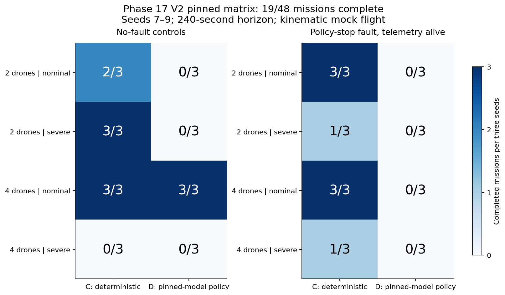
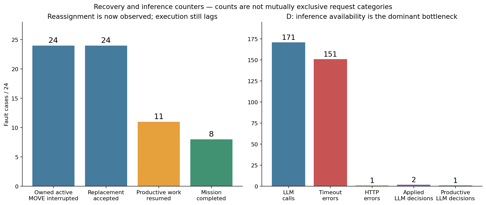
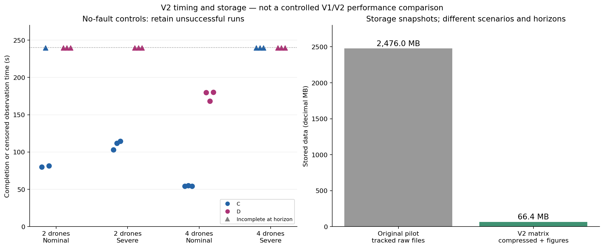

# Phase 17 V2 matrix testing — recovery progress, inference failures and remaining work

**V2 now demonstrates replacement-task acceptance in every fault case, but the pinned matrix does not demonstrate reliable agentic recovery.** All 48 experiments finished; 19 missions completed. Architecture C completed 16/24, while D completed 3/24. Most D requests timed out, and its three successful missions recorded no applied LLM decisions. Storage reduction succeeded.

This report reviews [results commit `adb11a9`](https://github.com/AkbasLab/carla_demo/commit/adb11a97c2faefb25250a182bd68b5f57c5f1313), under [`results/phase17/v2_matrix_run1`](../results/phase17/v2_matrix_run1). The original pilot report remains unchanged at [phase17_results.md](phase17_results.md). This is a pilot diagnosis, not a final architecture comparison or a completed Phase 17 calibration.

## 1. Matrix and evidence inspected

The uploaded matrix has 12 finished four-case batches: seeds 7–9 × two/four drones × nominal/severe communication. Each batch contains C control, C fault, D control and D fault, for **48 runs**. C uses deterministic rules; D attempts inference with the pinned Ollama model. All cases have a **240-second horizon**, four required tasks and 16 unique waypoint work units. Unfinished runs are censored near 239.8 s; that is not a successful completion time.

The default V2 fault stops Drone1's task policy during owned movement, while its independent physical telemetry service continues over the same degraded channel. The trigger and surviving service differ from V1's fixed-73-second whole-agent silence. The backend is kinematic mock flight, not CARLA-Air.

The review used all 12 batch manifests, all 48 metric records and all 48 case summaries. Mission success, completed task count, waypoint-work fraction, inference-call counts, productive LLM decision counts and error/evidence status were cross-checked between these records. Selected archived responses were also inspected to diagnose inference timeouts. It is not an independent re-evaluation of every raw message and flight trace.

All batch manifests report `finished`; no top-level run error or registered metric evidence issue is recorded. This does **not** mean that model requests succeeded: inference errors are handled inside runs and can trigger deterministic fallback. All 12 batches have `diagnostic_checks_passed=false` because their full set of intended mission/recovery checks did not pass.

The identity audit found a consistent `phase12-agent:pinned` model, digest `46e0c10c039e019119339687c3c1757cc81b9da49709a3b3924863ba87ca666e`, temperature 0, `num_ctx=8192`, `num_predict=512`, and Ollama server version 0.32.1. The reported source hashes are consistent across the batch manifests. A verified identity is not evidence of successful end-to-end inference.

## 2. Mission completion

Every entry below represents three seeds.

| Team | Communication | C control | C fault | D control | D fault |
| --- | --- | ---: | ---: | ---: | ---: |
| 2 | Nominal | 2/3 | **3/3** | 0/3 | 0/3 |
| 2 | Severe | **3/3** | 1/3 | 0/3 | 0/3 |
| 4 | Nominal | **3/3** | **3/3** | **3/3** | 0/3 |
| 4 | Severe | 0/3 | 1/3 | 0/3 | 0/3 |
| Total | | 8/12 | 8/12 | 3/12 | 0/12 |

Overall completion is **19/48 (39.6%)**. There are 29 incomplete missions, not 29 execution crashes. No-fault controls complete 11/24; fault cases complete 8/24. The uneven outcomes show why aggregate completion alone is insufficient.



C's four-drone nominal cases are consistent: controls complete at a median **54.4 s**, and fault missions at **129.2 s**. Its two-drone nominal fault missions complete at a median **199.4 s**. However, its four-drone severe controls complete **0/3**, and the two-drone nominal control for seed 8 also remains incomplete. Therefore deterministic execution is not fully stable across the selected conditions.

D completes only its three four-drone nominal controls, at 168.2, 179.8 and 180.0 s. These are fallback-supported successes, not successful LLM policy executions. All D two-drone controls and every D fault case remain incomplete.

The seed-8 severe C fault case can complete even when its matched control does not. This is not evidence that failure improves resilience: removing a task-policy participant changes traffic, task allocation and the motion schedule, and the conditional fault trigger changes the subsequent trajectory. Three paired observations do not isolate those mechanisms.

## 3. Recovery: acceptance improves, productive continuation remains incomplete

| Fault-case milestone | V1 | V2 | V2 C | V2 D |
| --- | ---: | ---: | ---: | ---: |
| Fault interrupted owned active MOVE | 14/24 | **24/24** | 12/12 | 12/12 |
| Replacement task accepted | 0/24 | **24/24** | 12/12 | 12/12 |
| Productive waypoint work resumed | 0/24 | **11/24** | 10/12 | 1/12 |
| Mission completed | 0/24 | **8/24** | 8/12 | 0/12 |

These counts establish that the revised diagnostic passes the previously missing **reassignment** step. They do not establish complete recovery in all cases. Replacement acceptance is local ownership evidence, not proof that a safe motion command was executed or that the task finished.

Median acceptance latency from fault onset is approximately **81.0 s for C** and **79.8 s for D**. Productive resumption is missing/censored in 13 fault cases, and full mission completion is missing in 16. Those missing recovery times must not be reported as zero.

The V1/V2 columns provide historical context only. V2 uses different seeds, an earlier movement-conditioned fault, surviving telemetry, different bidding/lease settings and a shorter mission budget. They cannot establish the isolated causal effect of the implementation changes. In particular, these V2 successes do not demonstrate complete radio-loss recovery.



## 4. Dominant D bottleneck: inference requests time out

Across the 24 D runs, the summaries record:

| Counter | Count |
| --- | ---: |
| LLM calls | **171** |
| Inference-timeout errors | **151** |
| HTTP errors | **1** |
| Applied LLM decisions | **2** |
| Productive LLM decisions | **1** |
| Deterministic fallback invocations | **154** |
| Successful D runs with an applied LLM decision | **0** |

These are different counters, not mutually exclusive request categories. They should not be added to reconstruct a complete request-outcome distribution. Every D run records at least one response error, and none reports `llm_integration_observed=true`.

Archived responses were inspected for these representative cases:

- `focused_n2_s7 / D_n2_nominal_control_s7`: six returned `TimeoutError` records, no applied policy decision.
- `focused_n4_s7 / D_n4_nominal_control_s7`: five returned `TimeoutError` records, no applied policy decision, despite full mission completion through fallback.
- `severe_n4_s9 / D_n4_severe_control_s9`: six timeout responses and two successful responses; two applied LLM decisions, one productive decision, but the mission remained incomplete.

The sampled timeout responses have latencies around **30.03 seconds**, matching the configured 30-second timeout. In the sampled nominal cases, stored request options retain the expected model settings and user-context strings are roughly 5.9–9.6 thousand characters. The available records do not establish whether the underlying cause is CPU/GPU placement, model-server load, competing requests, generation speed or another service issue. Do not diagnose a particular hardware failure without server evidence.

The key finding is that **successful inference is currently unavailable often enough that D mostly operates through fallback after waiting**. This matrix therefore does not fairly measure the quality or benefit of functioning LLM coordination. Merely increasing the mission duration could produce more fallback-driven completions while leaving the intended agentic architecture untested.

## 5. Safety and the remaining C execution problem

All 48 summaries report guarded dispatch. The registered metrics record zero sampled separation violations and zero sampled restricted-zone entries. **Collision observations were not collected**, so collision freedom and physical flight safety are not established.

There are **zero unverifiable-state rejections** in the recorded metrics, compared with the prominent stale-state blockage in V1. That is consistent with V2's explicitly surviving telemetry service making usable peer positions available. It is not a demonstration that unobservable peers can safely be ignored.

C still records **1,350 `unsafe_action:peer_reachable_region_conflict` policy errors** across its cases. The overall matrix has 1,953 corrective guardian interventions. These are repeated evaluations, not unique collisions or incidents. Alongside incomplete severe controls, they motivate investigation of approach paths, interacting motion schedules and conservative peer reachable regions. They do not justify reducing separation limits or deleting peers from safety checks.

Task acceptance is now observed even where execution stalls. The next coordination investigation should therefore trace acceptance → route revalidation → guarded dispatch → actual movement → first new waypoint, rather than stopping at the allocation event.

## 6. Time and storage goals

The 12 batches span approximately **2 hours 43 minutes**, compared with about 6 hours 29 minutes for the historical pilot. Their combined recorded mission time is about 2 hours 38 minutes. Setup, model warmup and analysis account for part of the difference between these measures. Different horizons and scenarios prevent interpreting this as an isolated architecture speedup.

Stored batch snapshots total approximately **66.4 MB** (63.3 MiB), versus about **2.48 GB** of tracked raw V1 data: approximately **97.3% less stored data**, and well below the requested approximately 250 MB target.

The V2 per-case raw sizes sum to approximately **1.12 GB before packing**. The storage success is therefore substantially a compression/retention result; it does not mean that only 66 MB of raw logs were generated. The full evidence remains available inside ZIP archives with recorded checksums.



Circles show completed controls. Triangles show incomplete controls observed to the horizon, not 240-second successful completions. The storage panel uses decimal MB and compares different scenario/budget snapshots; it is not a controlled performance experiment.

## 7. Phase 17 assessment and next steps

| Area | Assessment |
| --- | --- |
| Repeated small matrix | Collected: 48 cases, three development seeds per cell |
| Fault during owned motion | Demonstrated in all 24 fault cases under the new trigger |
| Replacement acceptance | Demonstrated in all 24 fault cases |
| Productive recovery | Partial: 11/24 resume work; 8/24 complete, all in C |
| Functioning pinned LLM policy | Not demonstrated reliably; timeouts dominate and successful D runs have no applied LLM decisions |
| Safety evidence | Guarded dispatch and sampled checks available; collision/live-flight claims unavailable |
| Storage reduction | Achieved through small stages, shorter budgets and lossless packing |
| Final freeze / Phase 18 readiness | **Not ready** |

Recommended order:

1. **Pause full-matrix repetition.** Preserve these outcomes and use a new output folder and development seed for each diagnostic change.
2. **Test the actual Ollama structured-request path before a mission.** Measure several representative calls, including full schema/context and output limits. Inspect model-server errors, hardware residency and concurrent workloads. Digest verification and an empty warmup are not sufficient readiness tests.
3. **Choose inference deadlines from measured latency, then align admission, task leases and context age.** Blindly raising one timeout can increase model-slot occupancy, stale decisions and expired assignments. Any change belongs to a new development pilot configuration.
4. **Repeat the four-case, four-drone nominal pinned stage first.** Require valid applied LLM decisions and attributable productive work, not just successful fallback execution. Verify the recovery chain before adding severe conditions or more seeds.
5. **Investigate C's severe execution conflicts separately.** Evaluate validated approach corridors, deterministic motion ordering or another admissible path/fallback while retaining the guardian's safety bounds. Log the reason for delays and task releases.
6. **Only then repeat and freeze a calibrated matrix.** Keep V2's conditional-fault/telemetry assumptions explicit. A final Phase 18 design requiring a common fixed fault time needs its own validated scenario definition; do not silently substitute this pilot trigger or tune on held-out results.

## 8. Reproducibility and scope

The [analysis summary](../results/phase17/v2_matrix_run1/review/analysis_summary.json) contains the aggregate counters and cross-check results. The [per-run CSV](../results/phase17/v2_matrix_run1/review/run_metrics.csv) preserves the seed-level outcomes behind the plots. The original case directories, ZIP evidence, metrics and timelines remain unchanged.

Regenerate the review from the full repository dataset into a fresh analysis folder:

```bash
python scripts/analyze_phase17_v2_matrix.py \
  --source-dir results/phase17/v2_matrix_run1 \
  --output-dir results/phase17/v2_matrix_run1/review_local1 \
  --source-commit adb11a97c2faefb25250a182bd68b5f57c5f1313
```

No mission was rerun and no experimental policy, network profile or safety rule was changed to produce this report. These three-seed pilot observations support debugging and methodology calibration, not a final statistical superiority claim for either architecture.
