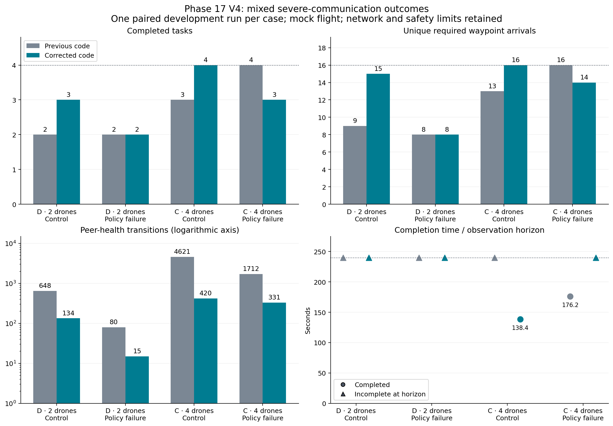
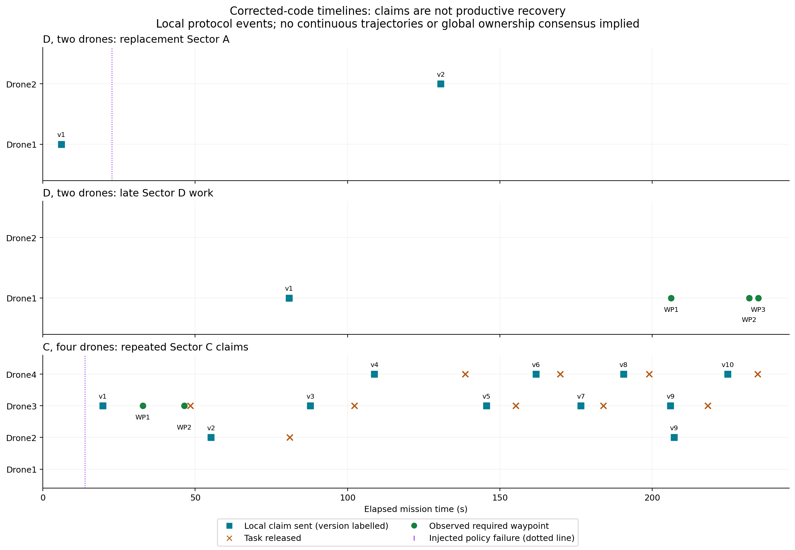

# Phase 17 V4 improvements: nominal and severe communication

This report preserves the development checks and subsequent pinned validation.
All flight results below use the mock adapter. Later sections distinguish
observed improvements, regressions and remaining implementation work.

## Evidence and diagnosis

The nominal A/B/C/D batches at seeds 11, 12, 15 and 20 show that A accepts a
replacement task but does not finish it. B's normal missions now succeed; its
lack of failed-peer takeover is intentional. C and D finish nominal recovery.

Inspection of `A_n2_nominal_loss_s11` exposed two separate issues:

1. The controller emits fresh task-authority renewals every beacon interval.
   The retry endpoint keyed them only by payload and suppressed the fresh
   timestamp while retransmitting an older authorization. The vehicle therefore
   repeatedly hit its three-second command timeout even on nominal transport.
2. Once those interruptions are removed, the stopped aircraft can physically
   obstruct a required waypoint. In the deterministic replay it stops at
   `(4.4, 0, -3)` while the waypoint is `(6, 0, -3)`. Their separation is only
   1.6 m. Even the far edge of the existing 0.4 m arrival region cannot satisfy
   the 2 m separation plus the guardian's conservative uncertainty allowance.

These are different problems. Correct message renewal does not make an occupied
waypoint safe, and an accepted replacement is not evidence of productive work.

## Changes

- `resilience.py`: a newly issued controller award supersedes an older pending
  renewal of the same assignment. Retries of each issuance retain its original
  timestamp and TTL. The command-timeout threshold is unchanged.
- `pilot_resilience_v2.py`: an idle structured-correction state no longer pauses
  the sampled geometric-blockage timer. Admitted inference and queued requests
  still pause it. Repeated identical actual unsafe decisions at an unchanged
  position use the existing rejection limit and require confirmed cancellation
  before releasing the task. Preview checks alone do not trigger this rule.
- `architectures.py`: vehicles report blocked approaches through the existing
  message bus. The controller logs the reason without counting it as progress
  or renewing the lease. After release it honors the V2 retry cooldown and
  defers the same blocked agent/task pairing while delivered physical geometry
  is unchanged. A position change of at least 0.2 m permits another feasibility
  check; it does not authorize movement. Other eligible agents remain candidates.
- `pilot_v2_runner.py`: adds `diagnostic_groups` for normal operation,
  recovery-capable A/C/D cases and independent B baseline outcomes. Existing
  `diagnostic_checks_passed` and `all_missions_complete` retain their original
  strict meanings for backward compatibility. B is not silently counted as a
  completed recovery mission.

Every movement still uses the existing deterministic approach planner and runtime
guardian. Geometry, arrival tolerance, speed/separation limits, lease duration,
inference timeout, fault predicate and 240-second mission budget are unchanged.
The renewal correction applies to the shared resilient transport; bounded
rejection recovery and geometry-based reassignment deferral are V2 behavior.

## Verification

Full offline suite: **302 tests passed**, followed by an additional passing
controller-link outage integration test. Focused regression suite: **39 tests
passed** before that additional test. Tests cover controller-renewal freshness
and retry expiry, genuine controller loss stopping both drones, inference
waiting, repeated rejection release, unchanged-geometry
deferral, delivered geometry changes, blocked arrival regions, and separate
diagnostic outcomes. The existing A/B runner integration verifies that B does not
negotiate and that a failed policy continues publishing only its own telemetry.

A fresh eight-case replay batch, nominal networking, two drones, seed 11:

| Architecture | Control tasks | Control completion time | Fault tasks | Fault completion time |
|---|---:|---:|---:|---:|
| A | 4/4 | 72.8 s | 3/4 | Not completed at 239.8 s |
| B | 4/4 | 63.4 s | 2/4 | Not completed at 239.8 s |
| C | 4/4 | 84.2 s | 4/4 | 149.0 s |
| D, replay only | 4/4 | 84.2 s | 4/4 | 149.0 s |

All eight cases are technically valid with guarded dispatched actions and zero
sampled separation violations. Collision sensing is unavailable. D's replay
times are not LLM latency or performance evidence and must not be compared with
the uploaded pinned runs as an isolated software-effect estimate.

In A's final fault replay, the replacement is accepted at 75.4 s. It reports the
blockage, releases the task at 107.4 s, and the controller does not repeatedly
assign that unchanged blocked approach. The physically obstructed work remains
unfinished. No waypoint arrival or mission success is fabricated.

## Small next tests

Start with A only, in a fresh output directory:

```bash
python -u scripts/run_phase17_resilience_v2.py run \
  --config configs/phase17/resilience_v2.json \
  --stage focused --profile pinned --architectures A \
  --team-size 2 --seed 11 --telemetry alive --fault-trigger owned_motion \
  --output-dir results/phase17/nominal_recovery_v3/a_n2_s11
```

A is deterministic; the selected pinned profile gives wall-clock execution but
does not turn A into an LLM architecture. Inspect `central_execution_blocked`,
`central_task_released`, `central_approach_recheck`, controller-command timeouts,
and waypoint arrivals. A physically blocked task may correctly remain incomplete.

Then run one matched regression batch, serially:

```bash
python -u scripts/run_phase17_resilience_v2.py run \
  --config configs/phase17/resilience_v2.json \
  --stage focused --profile pinned --architectures A B C D \
  --team-size 2 --seed 11 --telemetry alive --fault-trigger owned_motion \
  --output-dir results/phase17/nominal_recovery_v3/abcd_n2_s11
```

Preserve the old results. Do not increase the budget or relax safety merely to
obtain completion. If the intended study requires every required waypoint to
remain physically accessible after a policy failure, declare and validate that
scenario property prospectively. Changing routes, failure exposure, failure
fallback behavior or task-completion semantics creates a new scenario cohort.

Further C/D timing changes should follow measured detection, lease, admission,
acceptance and productive-resumption intervals; this change does not shorten
leases blindly or claim an LLM advantage.

## Pinned validation: nominal recovery V3

Results uploaded in commit `56a334c` include:

- `results/phase17/nominal_recovery_v3/a_n2_s11`
- `results/phase17/nominal_recovery_v3/abcd_n2_s11`

Both batches record clean source commit `00737f4`, which includes the corrections
from `9a80eff`. Their recorded source hashes match. Both used nominal networking,
two drones, development seed 11, surviving own-vehicle telemetry and the
`owned_motion` fault trigger. The execution-isolation lock was enabled.

### Comparison with the previous pinned seed-11 run

The previous results are in
`results/phase17/all_architecture_run1/focused_n2_s11`.

| Metric | Previous pinned run | V3 A/B/C/D batch |
|---|---:|---:|
| A normal mission completion time | 114.8 s | 78.0 s |
| A normal controller-command timeout events | 45 | 1 |
| A failure-case controller-command timeout events | 66 | 2 |
| A failure-case completed tasks | 3/4 | 3/4 |
| A replacement acceptance timestamp | 98.8 s | 76.0 s |
| Completed missions across A/B/C/D | 6/8 | 6/8 |

A's observed normal completion time decreases by approximately 32%. The separate
A-only batch gives a similar result: normal completion in 79.2 s, one normal
timeout event, and three of four tasks completed in the failure case. Its
replacement acceptance occurs at 75.4 s.

The remaining timeout events in the V3 A/B/C/D batch occur while the affected
vehicle owns no task: 48.0 s in the control, and 71.2 s and 113.8 s in the failure
case. They no longer repeatedly interrupt assigned work. These traces support
the intended controller-renewal correction; they do not establish a statistical
effect across multiple independent replications.

### Recovery behavior and the remaining physical blockage

In the V3 A/B/C/D failure case, the controller receives four blocked-execution
reports. The replacement releases Sector A at 111.0 s with reason
`peer_reachable_region_conflict`. The controller does not repeatedly assign the
same unchanged blocked approach. The A-only case similarly releases the task at
110.4 s. Both retain the stopped aircraft in the safety model and leave its
unfinished work incomplete.

The failed drone stops at approximately `(4.2, 0, -3)` in the A/B/C/D batch and
`(4.0, 0, -3)` in the A-only batch, near the required waypoint `(6, 0, -3)`.
The approach remains inadmissible under the existing arrival tolerance,
separation bound and conservative peer-uncertainty checks. No waypoint arrival
or safe passage should be inferred from replacement acceptance alone.

The earlier pinned run stopped the failed drone near `(3.0, 0, -3)`. Because the
fault is movement-triggered, correcting execution changes the physical fault
exposure even with the same seed. The earlier and V3 failure outcomes therefore
do not isolate an identical-geometry recovery effect.

### Other architectures and verification status

| Architecture | V3 normal mission | V3 policy-failure mission |
|---|---|---|
| B: independent persistent LLM | 4/4 tasks, 107.6 s | 2/4 tasks; incomplete at 239.8 s |
| C: deterministic decentralized | 4/4 tasks, 88.4 s | 4/4 tasks, 158.4 s |
| D: agentic decentralized | 4/4 tasks, 109.6 s | 4/4 tasks, 204.8 s |

B's lack of takeover is intentional. C and D retain successful nominal recovery.
B and D use actual LLM inference and record zero fallback-policy activations in
these cases. D's completion remains slower than C's; this pilot does not
demonstrate an LLM performance advantage.

Both batches finish with no reported runtime or metric errors, all dispatched
actions guarded, and zero sampled separation violations. Collision sensing
remains unavailable. The separate A-only pair is an additional execution check,
not another independent seed.

The new diagnostics correctly report normal-operation checks as passing and
identify A as the incomplete recovery-capable case. B's failure mission remains
an explicitly non-reassigning baseline outcome. The strict all-mission flag
remains false rather than concealing these incomplete outcomes.

**Assessment:** the changes meaningfully improve A's normal execution efficiency
and make blocked recovery bounded and auditable. Overall mission completion
remains unchanged. The next scenario-design decision is whether a failed
aircraft may physically obstruct required work, or whether a separately declared
and validated recovery mechanism must make that work accessible. Do not relax
the guardian or count blocked work as complete to resolve this limitation.

## Severe-communication development corrections

Status: implemented; new pinned-inference validation remains pending.
This section preserves the earlier nominal findings and describes a subsequent
development change, not a reinterpretation of the saved experiments.

### Evidence motivating the changes

The additional dataset in commit `a9c4352` is
`results/phase17/all_architecture_run1/severe_n2_s10`. It records source
`56a334c`, includes the nominal fixes, and completes two of eight missions.
Its task counts are:

| Architecture | Severe control | Severe policy failure |
|---|---:|---:|
| A | 4/4 | 3/4 |
| B | 3/4 | 2/4 |
| C | 4/4 | 3/4 |
| D | 1/4 | 2/4 |

Here “control” means no injected policy failure; communication is still severe.
Earlier four-drone severe seeds 10 and 20 also show repeated safety waits,
handover churn and frequent peer-health transitions. Their source predates the
nominal fixes, so they are supporting diagnostic evidence, not a matched test of
the latest implementation. The uploaded four-drone severe seed-10 batch lacks
its two D cases and must not be counted as eight finished runs.

One concrete defect appears in `C_n2_severe_loss_s10`: at approximately 155.8 s,
Drone2 is at `(6, 0.35, -3)`, within the 0.4 m tolerance of Sector A's first
waypoint `(6, 0, -3)`, while owning its current task epoch. No Sector A arrival is
recorded. The executor checked prospective movement safety before recording
already observed work, so a rejection could prevent checkpoint advancement.

### Implementation

1. **Arrival observations precede next-command checks.** `persistent.py` now
   reconciles an arrival for an existing executor, current owned epoch and fresh
   own-position observation. V2 performs the same reconciliation before its
   approach preview. Stale own telemetry and old epochs cannot create arrivals.
   Recording a real arrival does not authorize the next movement; the guardian
   still checks every dispatched action. A reached final waypoint can finish a
   task without requiring another MOVE approval at that same position.
2. **Progress follows the selected approach.** V2 supplies the waypoint executor
   with remaining distance along its selected detour. Actual reduction can renew
   the existing lease even when straight-line distance to the mission waypoint
   initially increases. Creating or changing a plan resets the measurement
   baseline; it does not count as progress. Stationary observations, model
   waiting and intermediate staging points do not create mission work.
3. **Cached approaches are revalidated.** If a newly delivered peer observation
   blocks the cached next segment, V2 discards that approach and searches again
   from the current local state. Unknown or stale state still fails closed.
4. **Shorter detours are tried first.** The deterministic planner tries a narrower
   lateral candidate before its existing larger offsets. Every full candidate
   leg still passes the original occupancy/static/battery screens, and every
   live segment still passes the guardian. This changes candidate ordering,
   not minimum separation, uncertainty bounds or speed limits.
5. **V2 role-health recovery is debounced.** A suspected peer requires sustained
   fresh heartbeat evidence over the existing one-second recovery dwell before
   returning to HEALTHY. Duplicate and older heartbeat timestamps do not
   rejuvenate it. The three-second unreachable threshold, raw-heartbeat
   coordination eligibility, physical occupancy and guardian freshness checks
   remain unchanged. This does not implement partition consensus or certify a
   failed vehicle's safe rejoin.

The mission budget, network profile, lease length, arrival tolerances, model
settings and fault trigger are unchanged. The severe profile remains 400 ms mean
latency, 200 ms jitter, 30% independent loss, 60 messages/s and 50,000 bytes/s.
These are application-network experiment settings, not measured radio claims.

### Offline checks and limits

A regression first reproduced the missing-arrival defect, then passed with the
correction. Additional checks cover stale observations and old epochs, blocked
cached approaches, energy-feasible shorter detours, sustained health recovery,
real detour progress, and no renewal from stationary replanning.
The full offline suite passes **310 tests**.

A fresh two-drone severe replay at seed 10 finishes all eight cases without
runtime or metric errors, with six completed missions. Its outcomes are:

| Architecture | Control | Policy failure |
|---|---|---|
| A | 4/4, 63.6 s | 3/4, timeout |
| B, replay policy | 4/4, 68.4 s | 2/4, timeout |
| C | 4/4, 87.8 s | 4/4, 187.4 s |
| D, replay policy | 4/4, 87.8 s | 4/4, 187.4 s |

The pre-change matched A/C replay completed A's control in 72.8 s, C's control in
116.2 s and C's failure mission in 191.8 s. A's failure mission completed three
tasks in both versions. Thus this small replay shows shorter successful times,
not an increase in A/C mission-success counts. Changed execution can also change
the physical position at a movement-triggered fault.

Replay B/D are not actual LLM measurements. These numbers cannot establish a
pinned-model completion improvement, a statistical architecture ranking, or live
flight safety. All new pilot data must remain separate from the saved older
runs. No held-out seed was used for these checks.

An additional four-drone C severe replay at development seed 20 completes both
cases: 64.4 s for the control and 145.8 s for policy failure. Across these ten
post-change replay cases, all dispatched actions are guarded, no sampled
separation violation is recorded, and no runtime or metric error is reported.
The two batches occupy approximately 8.2 MiB after lossless packing. They are
temporary offline validation artifacts, not newly published pinned results.

### Test in small, serial batches

Run the offline regressions first; CARLA-Air and Ollama are not needed:

```bash
MPLCONFIGDIR=/tmp/phase17-mpl python -m unittest \
  tests.test_phase17_recovery_regressions \
  tests.test_phase17_all_architectures \
  tests.test_phase13_resilience -q
```

For actual inference, keep the pinned Ollama model from
`configs/phase17/resilience_v2.json` available and run one batch at a time. The
following helper fixes team size and seed and creates separate output folders:

```bash
check_severe_fix() {
  python -u scripts/run_phase17_resilience_v2.py run \
    --config configs/phase17/resilience_v2.json \
    --stage "$1" --profile pinned --architectures "$2" \
    --team-size 2 --seed 10 \
    --telemetry alive --fault-trigger owned_motion \
    --output-dir "results/phase17/severe_recovery_v4/${1}_${2}_n2_s10"
}

check_severe_fix focused C
check_severe_fix severe C
check_severe_fix severe D
```

Each command creates only two cases: control and policy failure. Inspect each
batch before running the next. C is deterministic; D requires actual pinned
inference. A useful result includes recorded real waypoint arrivals, replacement
acceptance and productive resumption, with no runtime/metric errors and all
actions guarded. A false aggregate diagnostic is an outcome to inspect, not a
reason to discard a run or silently increase its duration.

Once those checks are understood, test the remaining baselines separately:

```bash
check_severe_fix severe A
check_severe_fix severe B
```

A may retain physically obstructed work. B must finish its own surviving work
but still cannot take over a failed peer's assignments. Do not add negotiation
to B simply to improve its score.

Then check the previously problematic four-drone seed-20 case without launching
a full matrix:

```bash
python -u scripts/run_phase17_resilience_v2.py run \
  --config configs/phase17/resilience_v2.json \
  --stage severe --profile pinned --architectures C D \
  --team-size 4 --seed 20 --telemetry alive --fault-trigger owned_motion \
  --output-dir results/phase17/severe_recovery_v4/severe_cd_n4_s20
```

Inspect `waypoint_arrivals.json`, `progress_reported` and `lease_expired` protocol
events, `alternative_approach_invalidated`, `alternative_approach_selected`,
`peer_health_changed`, policy errors and guardian audits. The existing Evidence
reader can read losslessly packed traces without restoring all raw JSON files.
Retain the archives and use another new folder for any repeat attempt.

Long model admission delays and genuinely infeasible approaches may still cause
incompletion. These changes do not enlarge leases merely because an LLM is
waiting, delete uncertain physical peers, or guarantee every severe case will
complete in 240 seconds. Pinned validation must establish the remaining effect.

## Verified V4 results: D with two drones and C with four drones

Commit `9176497` adds these batches:

- `results/phase17/severe_recovery_v4_verified/severe_D_n2_s10`
- `results/phase17/severe_recovery_v4_verified/severe_C_n4_s20`

Both record clean source `dc696f4`. Their saved hashes for the four corrected
source files match `f0b9e57`, confirming that the V4 corrections were active.
Each batch contains a no-policy-failure control and a policy-failure case under
severe communication. These are mock-flight development pilots, not live
CARLA-Air or final held-out experiments.

### Comparison with the preceding older-code batches

The preceding references are `severe_recovery_v4/severe_D_n2_s10` and the C cases
in `severe_recovery_v4/severe_cd_n4_s20`.

| Case | Previous result | Corrected-code result |
|---|---|---|
| D, two drones, seed 10, control | 2/4 tasks; 9 waypoint arrivals | 3/4 tasks; 15 arrivals; timeout |
| D, two drones, seed 10, failure | 2/4 tasks; 8 arrivals | 2/4 tasks; 8 arrivals; timeout |
| C, four drones, seed 20, control | 3/4 tasks; 13 arrivals; timeout | 4/4 tasks; 16 arrivals; 138.4 s |
| C, four drones, seed 20, failure | 4/4 tasks; 16 arrivals; 176.2 s | 3/4 tasks; 14 arrivals; timeout |

Timeout observations end at approximately 239.8 s; they are not successful
completion times. Across these four cases, completed-mission count remains one
of four: C's control improves, while its failure case regresses. Single paired
development observations cannot establish a general speed or architecture
advantage. With an owned-motion trigger, changed execution can also change the
failure time and physical exposure.

### Visual comparison



**Figure 1.** Severe-network comparisons for D with two drones, seed 10, and C
with four drones, seed 20. Grey denotes the preceding code and teal the corrected
implementation. D's control completes more work, and C's control completes the
mission, while C's failure case regresses. The peer-health panel uses a
logarithmic axis and labels the raw counts. Circles are successful completion
times; triangles are incomplete observations at the approximately 240-second
horizon, not fast or successful completions. One paired development run per
case is shown; these are not estimates of statistical significance.

[Download Figure 1 as PDF](figures/phase17_v4/severe_comparison.pdf).

### Mechanism-level evidence

| Diagnostic | Previous | Corrected code |
|---|---:|---:|
| D control peer-health transitions | 648 | 134 |
| D failure peer-health transitions | 80 | 15 |
| C control peer-health transitions | 4,621 | 420 |
| C failure peer-health transitions | 1,712 | 331 |
| D control approach invalidations | 0 | 11 |
| D failure approach invalidations | 0 | 6 |
| C control approach invalidations | 0 | 2 |
| C failure approach invalidations | 0 | 7 |

Lower health-transition counts support the intended debounce mechanism.
Approach-invalidations demonstrate that cached-route revalidation is active;
more invalidations do not themselves establish better planning.

All four corrected-code cases finish their allotted execution with no recorded
runtime or metric errors. All dispatched actions are guarded and no sampled
separation violation is reported. Collision sensing remains unavailable, so
these records do not prove collision freedom.

D uses actual pinned LLM inference. The inspected response records contain no
inference errors and mean response latency is approximately 10.0 s in the
control and 9.6 s in failure. Both cases record zero fallback-policy activations.
Increasing the inference timeout is therefore not the first explanation or
remedy for these incomplete missions.

### Remaining execution problems

**D control: late productive work.** Sector D is claimed at 80.8 s, but its first
waypoint arrival occurs at 206.2 s. WP2 and WP3 follow at 231.8 s and 234.8 s.
The run ends with three completed tasks and only Sector D's final waypoint
missing. The additional observed work is meaningful, but the mission remains
incomplete.

**D failure: replacement accepted without productive resumption.** Sector A is
claimed by the replacement at 130.6 s, but no replacement waypoint arrival is
recorded before timeout. The remaining drone repeatedly selects approaches and
receives search authorizations. At the end it is still assigned Sector A;
Sector D also remains unfinished. Reassignment alone is not mission recovery.

**C failure: repeated reclaiming of a blocked task.** Sector C records WP1 and
WP2 at 32.8 s and 46.4 s, but WP3 and WP4 remain unfinished. The task advances
through ten assignment versions as agents repeatedly claim and release it.
Drone3 and Drone4 continue trading the task while the physical blockage
persists. The run contains 237 guardian reason occurrences of
`peer_reachable_region_conflict`, compared with 18 in the preceding successful
failure case. These are intervention records, not counts of collisions.

The corrected C failure still recovers the deliberately failed drone's Sector A
and completes three sectors overall. Its remaining Sector C failure shows that
failure-triggered reassignment and full mission recovery must be assessed
separately.

### Timelines of unfinished work



**Figure 2.** Local protocol events explain why assignments alone are insufficient
evidence of recovery. Top: D's replacement claims Sector A but records no required
waypoint arrival. Middle: D's control claims Sector D early but records its three
arrivals only near the horizon; WP4 remains missing. Bottom: C's failure case
repeatedly trades Sector C across assignment versions after WP2, without reaching
WP3 or WP4. Squares are local claims, crosses releases, green circles observed
arrivals, and purple dotted lines the injected policy failure. The control panel
has no injected fault. These event records are not continuous flight paths or a
global ownership-consensus trace.

[Download Figure 2 as PDF](figures/phase17_v4/remaining_task_timelines.pdf).

Both figures read saved JSON and losslessly packed traces directly. Their
numeric inputs and source folders are saved in
[figure_data.json](figures/phase17_v4/figure_data.json). Regenerate them from the
repository root with:

```bash
MPLCONFIGDIR=/tmp/phase17-mpl python scripts/plot_phase17_v4_improvements.py
```

### Recommended next source-code work

1. Preserve rejected-approach knowledge across task versions and communicate
   meaningful blockage evidence. Avoid rebidding for the same unchanged
   obstruction simply because its assignment epoch advanced.
2. Distinguish a temporarily unverifiable segment from materially changed
   physical geometry. Wait safely for temporary uncertainty; replan when the
   selected approach is genuinely invalid. Prevent repeated planning and
   authorization cycles from undoing useful approach progress.
3. Track cumulative approach effort and time since a required waypoint arrival,
   separately from lease validity. Actual detour motion can legitimately renew
   a lease without producing useful mission work. Bound unsuccessful effort and
   invoke a validated help, yielding or release response when needed.

These are recommendations, not additional implemented fixes. Any yielding
movement must pass the same guardian and preserve conservative occupancy for
silent peers. Inspect these representative traces before running another large
matrix. The current evidence supports a stronger implementation foundation but
does not yet demonstrate reliable severe recovery across C and D.
