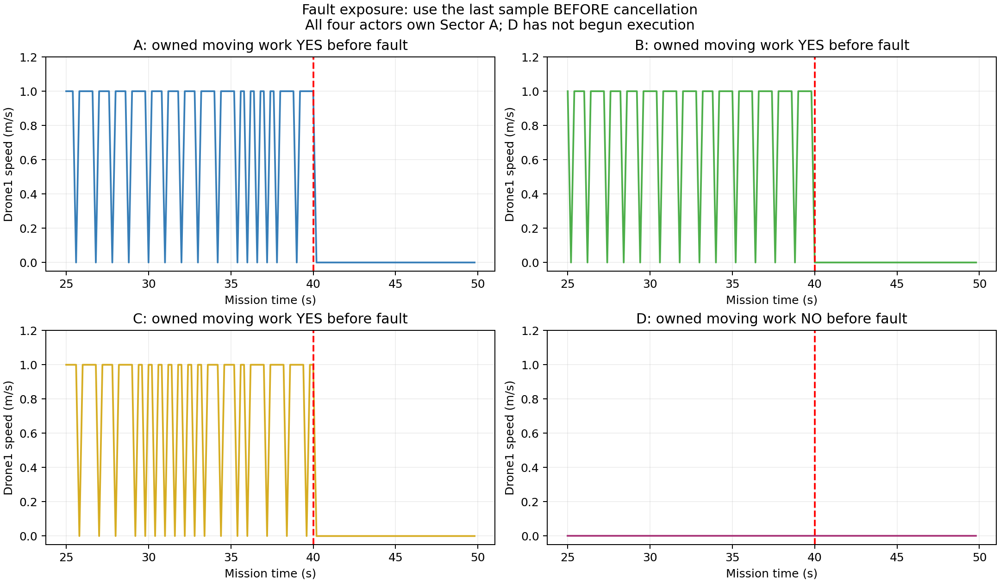
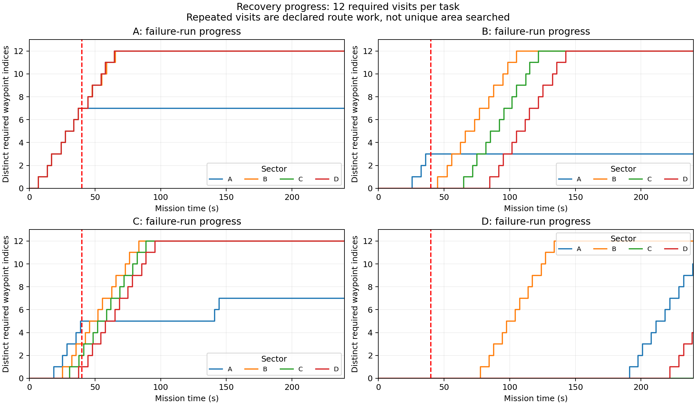

# Fixed-time calibration precheck results

Inspected uploaded commit `d9e7c4b`, covering `results/phase17/fixed_time_v4_precheck_A1`, `B1`, `C1` and `D1`. These are eight mock-flight runs: one nominal control and one nominal policy-stop run per architecture, four drones, development seed 10. They are not held-out main experiments or a completed calibration matrix. The uploaded inner manifests have matching source-hash dictionaries and shared-input hashes across these runs.

## What the checks show

| Architecture | Control outcome | Fixed-time failure outcome | Owned moving work just before 40 s? |
|---|---|---|---|
| A: centralized rules | 4/4; 66.0 s | 3/4; incomplete | Yes; 1.0 m/s |
| B: independent persistent LLM | 4/4; 142.6 s | 3/4; incomplete | Yes; 1.0 m/s |
| C: decentralized rules | 4/4; 94.2 s | 3/4; incomplete | Yes; 1.0 m/s |
| D: decentralized LLM | 4/4; 224.8 s | 1/4; incomplete | **No; 0 m/s at spawn** |

All failure observations end at approximately 239.8 seconds in the declared 240-second budget. These are observation times, not successful completion times. No run-level error is reported. A/B/C lose Sector A; D completes only Sector B. A/C are deterministic policies; their stored policy-history files do not imply actual model inference.


## Inspect fault exposure before inspecting recovery

For each architecture, open:

```text
results/phase17/fixed_time_v4_precheck_<ARCH>1/<ARCH>_n4_nominal_loss_s10/run/
```

The `run/` level matters: the outer directory contains the experiment-runner manifest and normalized events; the inner directory contains the raw flight and protocol evidence.

1. `scenario_events.json`: locate `actor_silenced` and `injection_cancel_ack`.
2. `flight_trace.json`: select Drone1's last sample **strictly before** that event. A cancellation may already have changed the command at the fault sample itself.
3. Require an unexpired owned task, matching `execution_task_id`, `active_command_kind == MOVE`, and nonzero speed. Task ownership alone is insufficient.
4. Follow the same task and version through `controller_events.json` for A, or `protocol_events.json` for C/D; verify new work using `waypoint_arrivals.json`.
5. Inspect policy errors/model histories and `guardian_audit.json` when this chain stalls.

All four fault events occur at 40.0002–40.0003 s and cancellation acknowledgments are confirmed. The preceding samples are approximately 39.8 s. Drone1 owns Sector A in all four runs. A/B/C have an active MOVE and speed 1 m/s. D has no execution task or active movement command and remains at `[0, 0, -3]`. Its one recorded Drone1 prompt begins at 28.2 s, with no stored completed response for that failed actor. This does not establish a provider error; no productive decision/movement had been applied before the policy stop.



## Follow the recovery chain

| Architecture | First replacement execution starts | First new required visit on interrupted task | Interpretation |
|---|---:|---:|---|
| A | 113.6 s | None by horizon | Reassignment/execution starts, but no new Sector A visit is recorded |
| B | None | None | Expected independent baseline: no negotiated takeover |
| C | 127.0 s | 141.0 s | Productive recovery begins, but Sector A remains incomplete |
| D | 153.4 s | 191.2 s | Reassignment and some productive work occur, but original moving-work exposure was absent |

These are **execution-start** timestamps, not substituted task-acceptance measurements. A required visit is keyed by task and waypoint index, so retrying a previously recorded visit is not counted as new productive work. Repeated route laps are declared waypoint work, not new sensed search area.

A: the controller expires Drone1's original Sector A lease at 112.6 s. Drone2 starts version 2 at 113.6 s, resuming at index 7. Further releases and assignments follow. Policy errors repeatedly report `unsafe_action:peer_reachable_region_conflict`; guardian audits include runtime/state violations and `no_verified_safe_fallback`. Reassignment alone has not solved safe execution near the retained physical drone.

B: the remaining drones complete their initial sectors, but no takeover of Sector A occurs. That is consistent with B's deliberately non-coordinating architecture and should remain an unfavorable valid baseline outcome.

C: a survivor observes expiration at 114.2 s, reannounces version 2, computes a bid at 114.4 s, claims at 120.4 s and starts execution at 127.0 s. New Sector A visits appear at 141.0 and 144.6 s. Subsequent safety rejections/releases prevent full completion. This establishes partial productive recovery, not successful mission recovery.

D: the original lease expires around 81.4 s after the actor was stopped at spawn. A replacement starts Sector A at 153.4 s and records new work at 191.2 s. The summary also records task-context changes and one survivor inference timeout. Its control only finishes at 224.8 s, leaving little headroom in a 240-second experiment. These traces do not isolate model latency from scheduling and coordination overhead.



## Calibration decision and next step

**Do not freeze this candidate or launch the full 48-case calibration yet.** A/B/C provide usable interrupted-motion exposure for this seed; D does not. The four controls are useful positive references, but all coordinating failure cases remain incomplete and D has little timing headroom. One seed cannot establish final network-level calibration or architecture superiority.

Retain these results. First inspect/measure D's startup admission, bidding and inference-to-dispatch delay, and A/C's blocked Sector A approach near the stopped physical drone. Any correction must preserve the conservative peer occupancy. Do not remove the stopped drone from safety checks or retrospectively shift its fault. If task timing, fault time, route, prompt or rules change, declare a revised candidate and use fresh folders. A later shared fault alone must also be checked against A's short control completion time; merely increasing 40 s may miss A's active work.

After focused fixes, rerun small matched control/failure batches, then validate exposure and useful outcomes across development seeds and both team sizes before full calibration. No held-out seeds are needed for this work. These are nominal communication checks; they do not yet establish why severe degradation is meaningful.

## Reproduce the figures without rerunning experiments

```bash
MPLCONFIGDIR=/tmp/phase18-mpl python scripts/plot_phase18_fixed_time_prechecks.py \
  --results-root results/phase17 \
  --output-dir docs/figures/phase18_fixed_time_prechecks
```

The script reads existing artifacts only and saves three PNGs plus `inspection.json` containing the extracted measurements. This is a retrospective diagnostic, not a replacement for the registered metrics or freeze gates.
