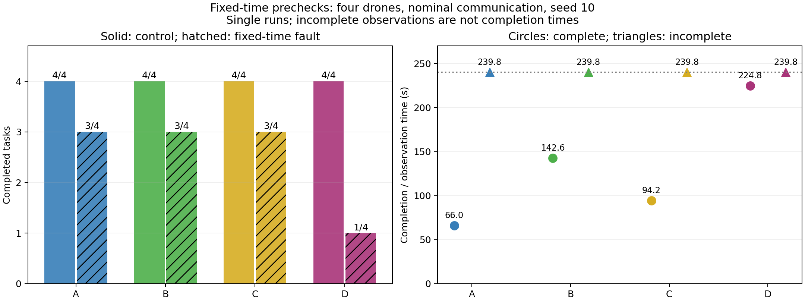
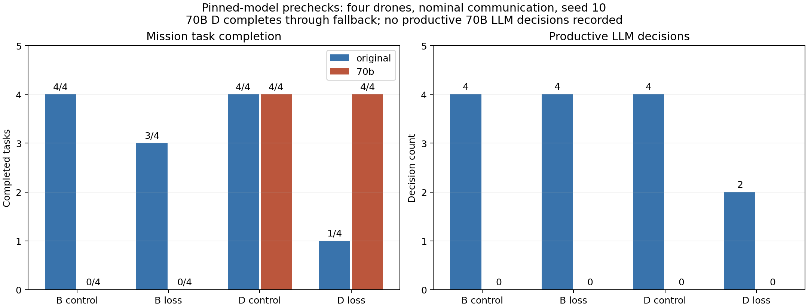

# Fixed-time calibration precheck results

Inspected uploaded commit `d9e7c4b`, covering `results/phase17/fixed_time_v4_precheck_A1`, `B1`, `C1` and `D1`. These are eight mock-flight runs: one nominal control and one nominal policy-stop run pe[...]

## What the checks show

| Architecture | Control outcome | Fixed-time failure outcome | Owned moving work just before 40 s? |
|---|---|---|---|
| A: centralized rules | 4/4; 66.0 s | 3/4; incomplete | Yes; 1.0 m/s |
| B: independent persistent LLM | 4/4; 142.6 s | 3/4; incomplete | Yes; 1.0 m/s |
| C: decentralized rules | 4/4; 94.2 s | 3/4; incomplete | Yes; 1.0 m/s |
| D: decentralized LLM | 4/4; 224.8 s | 1/4; incomplete | **No; 0 m/s at spawn** |

All failure observations end at approximately 239.8 seconds in the declared 240-second budget. These are observation times, not successful completion times. No run-level error is reported. A/B/C lose [...]



## Inspect fault exposure before inspecting recovery

For each architecture, open:

```text
results/phase17/fixed_time_v4_precheck_<ARCH>1/<ARCH>_n4_nominal_loss_s10/run/
```

The `run/` level matters: the outer directory contains the experiment-runner manifest and normalized events; the inner directory contains the raw flight and protocol evidence.

1. `scenario_events.json`: locate `actor_silenced` and `injection_cancel_ack`.
2. `flight_trace.json`: select Drone1's last sample **strictly before** that event. A cancellation may already have changed the command at the fault sample itself.
3. Require an unexpired owned task, matching `execution_task_id`, `active_command_kind == MOVE`, and nonzero speed. Task ownership alone is insufficient.
4. Follow the same task and version through `controller_events.json` for A, or `protocol_events.json` for C/D; verify new work using `waypoint_arrivals.json`.
5. Inspect policy errors/model histories and `guardian_audit.json` when this chain stalls.

All four fault events occur at 40.0002–40.0003 s and cancellation acknowledgments are confirmed. The preceding samples are approximately 39.8 s. Drone1 owns Sector A in all four runs. A/B/C have an [...]


## Follow the recovery chain

| Architecture | First replacement execution starts | First new required visit on interrupted task | Interpretation |
|---|---:|---:|---|
| A | 113.6 s | None by horizon | Reassignment/execution starts, but no new Sector A visit is recorded |
| B | None | None | Expected independent baseline: no negotiated takeover |
| C | 127.0 s | 141.0 s | Productive recovery begins, but Sector A remains incomplete |
| D | 153.4 s | 191.2 s | Reassignment and some productive work occur, but original moving-work exposure was absent |

These are **execution-start** timestamps, not substituted task-acceptance measurements. A required visit is keyed by task and waypoint index, so retrying a previously recorded visit is not counted as [...]

A: the controller expires Drone1's original Sector A lease at 112.6 s. Drone2 starts version 2 at 113.6 s, resuming at index 7. Further releases and assignments follow. Policy errors repeatedly report[...]

B: the remaining drones complete their initial sectors, but no takeover of Sector A occurs. That is consistent with B's deliberately non-coordinating architecture and should remain an unfavorable vali[...]

C: a survivor observes expiration at 114.2 s, reannounces version 2, computes a bid at 114.4 s, claims at 120.4 s and starts execution at 127.0 s. New Sector A visits appear at 141.0 and 144.6 s. Subs[...]

D: the original lease expires around 81.4 s after the actor was stopped at spawn. A replacement starts Sector A at 153.4 s and records new work at 191.2 s. The summary also records task-context change[...]


## Calibration decision and next step

**Do not freeze this candidate or launch the full 48-case calibration yet.** A/B/C provide usable interrupted-motion exposure for this seed; D does not. The four controls are useful positive reference[...]

Retain these results. First inspect/measure D's startup admission, bidding and inference-to-dispatch delay, and A/C's blocked Sector A approach near the stopped physical drone. Any correction must pre[...]

After focused fixes, rerun small matched control/failure batches, then validate exposure and useful outcomes across development seeds and both team sizes before full calibration. No held-out seeds are[...]

## Reproduce the figures without rerunning experiments

```bash
MPLCONFIGDIR=/tmp/phase18-mpl python scripts/plot_phase18_fixed_time_prechecks.py \
  --results-root results/phase17 \
  --output-dir docs/figures/phase18_fixed_time_prechecks
```

The script reads existing artifacts only and saves three PNGs plus `inspection.json` containing the extracted measurements. This is a retrospective diagnostic, not a replacement for the registered met[...]

## Follow-up: pinned 70B B/D prechecks

Inspected commit `475b474`, adding `fixed_time_v4_precheck_B70b_run1` and `fixed_time_v4_precheck_D70b_run1` under `results/phase17`. These are four additional single-seed nominal runs, not new succes[...]

The recorded model is `phase18:pinned`, with digest `a6eb4748fd2990ad2952b2335a95a7f952d1a06119a0aa6a2df6cd052a93a3fa`, identified by the experimenter as the 70B model. A name and digest pin its ident[...]

| Case | Original model | 70B outcome | Productive 70B LLM decisions | Recorded timeout responses | 70B fallback-authorized arrivals |
|---|---|---|---:|---:|---:|
| B control | 4/4; 142.6 s | 0/4; incomplete at 239.8 s | 0 | 7 | 0 |
| B failure | 3/4; incomplete | 0/4; incomplete at 239.8 s | 0 | 7 | 0 |
| D control | 4/4; 224.8 s | 4/4; 223.2 s | 0 | 5 | 48 |
| D failure | 1/4; incomplete | 4/4; 237.4 s | 0 | 5 | 48 |



### Model deadlines, not demonstrated reasoning improvement

All **24 stored response records** in the new runs contain `error_type: TimeoutError`, with observed request durations approximately 30.01–30.04 s. These are timeout durations, not successful infere[...]

B records no waypoint arrivals and no productive LLM decisions. Drone1 never moves in either B run. Thus the larger-model configuration is worse operationally than the original B prechecks within the [...]

D completes both missions, but every one of the 48 recorded arrivals in each run is authorized by `deterministic_fallback`. Its productive LLM decision count is zero for every agent. This is evidence [...]

### Fixed-time exposure remains invalid for interrupted motion

Both 70B failure runs stop Drone1 at approximately 40.0001 s with confirmed cancellation. Immediately before the fault, Drone1 owns Sector A but remains at `[0, 0, -3]`, with zero velocity and no exec[...]

The D failure nevertheless demonstrates recovery of unstarted owned work: Drone2 starts Sector A version 2 at 142.4 s, records its first required visit at 155.6 s and its last at 213.4 s. All four tas[...]

### What to do before further calibration

Preserve these four runs as valid unfavorable/diagnostic outcomes. Do not freeze this candidate on the basis of D's completion. First test one saved structured request against the pinned 70B serv[...]

If warm requests exceed 30 s, the current 70B deployment does not meet the current decision budget. A longer timeout, different concurrency, quantization or a smaller model is a changed experimental t[...]

The separately identified A/C safe remaining-route execution issue is unchanged by these B/D model trials. Address that mechanism without deleting the stopped physical drone or weakening separation ch[...]

To reproduce the added comparison from the uploaded artifacts:

```bash
MPLCONFIGDIR=/tmp/phase18-mpl python scripts/plot_phase18_70b_prechecks.py
```

This writes `docs/figures/phase18_70b_prechecks/model_comparison.png` and `comparison.json`. It does not call Ollama or rerun missions.

Under the 70B configuration, Architecture D completed the missions through deterministic fallback mechanisms, while Architecture B made no progress; however, because no productive LLM decisions were recorded, these results do not demonstrate a reasoning advantage from the larger model.
