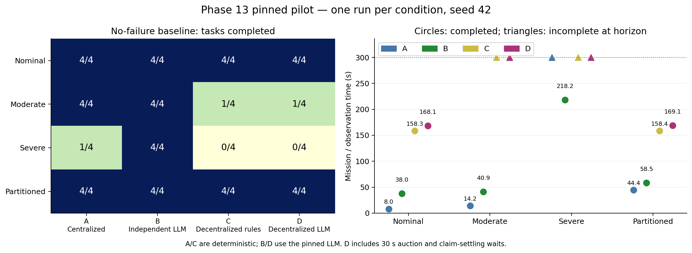
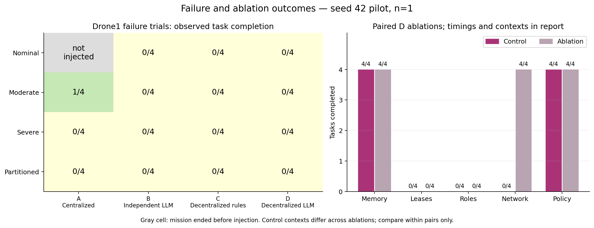
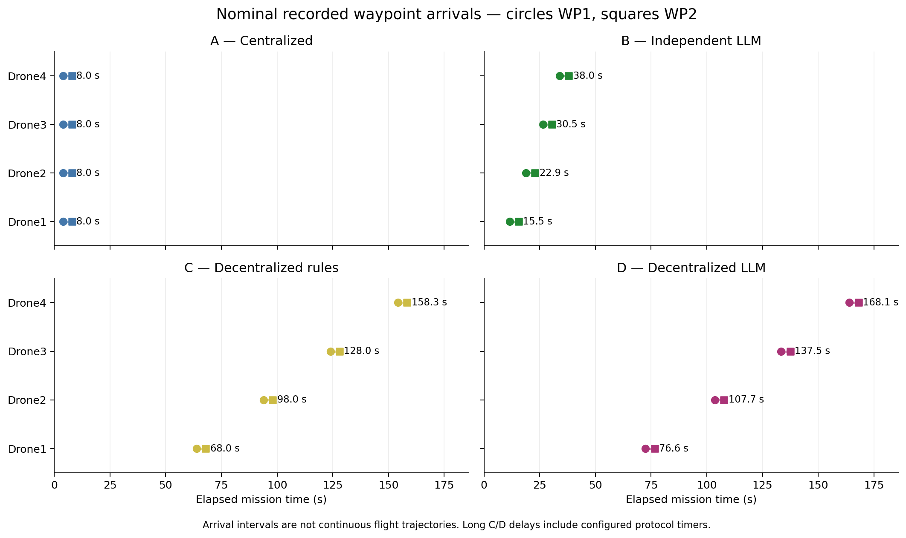
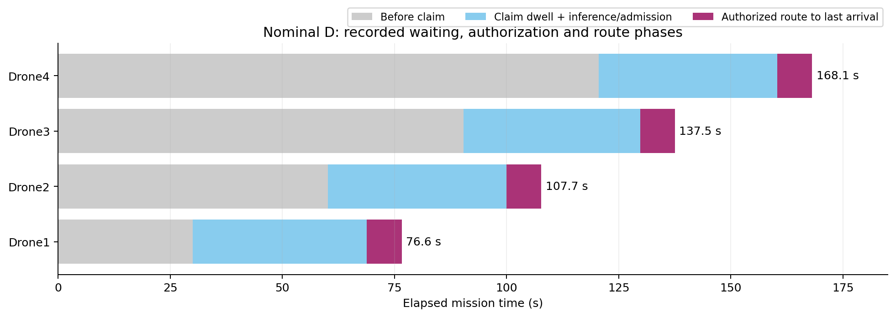
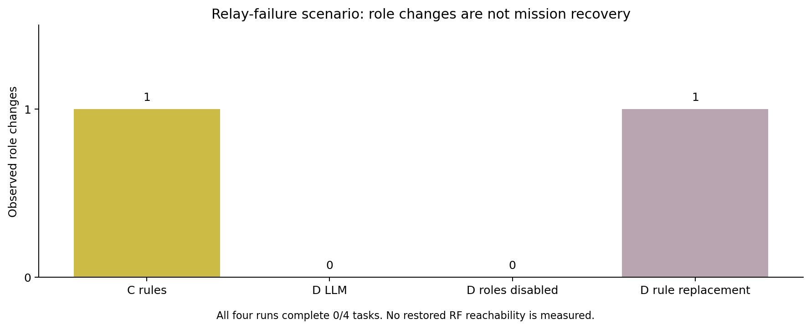
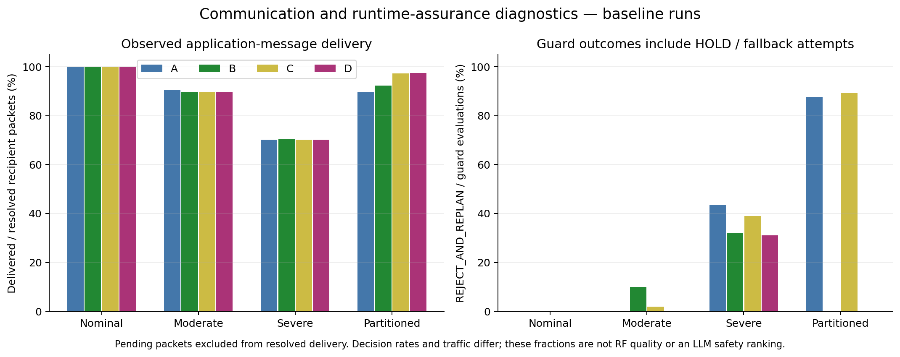

# Phase 13 initial pinned-suite analysis
Source commit: `a7d40605d52438358df9d502c7967e1f17772d46`. Scope: `results/phase13/automated_pinned_run1` only.
Uploaded 40 of 40 planned cases; 21 use actual Ollama. All are mock-flight experiments.

## No-failure baseline

| Condition | A | B | C | D |
|---|---|---|---|---|
| nominal | 8.0 s; 4/4 | 38.0 s; 4/4 | 158.3 s; 4/4 | 168.1 s; 4/4 |
| moderate | 14.2 s; 4/4 | 40.9 s; 4/4 | incomplete; 1/4 at 299.9 s | incomplete; 1/4 at 299.9 s |
| severe | incomplete; 1/4 at 299.9 s | 218.2 s; 4/4 | incomplete; 0/4 at 299.9 s | incomplete; 0/4 at 299.9 s |
| partitioned | 44.4 s; 4/4 | 58.5 s; 4/4 | 158.4 s; 4/4 | 169.1 s; 4/4 |

A is the fastest nominal baseline. B completes all four no-failure conditions in this pilot. C/D both complete only one task under moderate degradation and none under severe degradation. These data do not demonstrate an agentic decentralized performance advantage.

C/D retain 30-second auction and claim-settling waits. D nominal claims occur near 30, 60, 90 and 120 seconds; its searches start near 69, 100, 130 and 160 seconds. Thus the A/D timing gap combines protocol waiting, model latency and architectural differences. It is not a standalone measure of LLM reasoning quality.
D remains a hybrid: deterministic contract-net ownership and deadline-protected bids support allocation. Productive LLM movement decisions establish policy execution, not by themselves LLM-driven negotiation or a benefit over the deterministic protocol.

## What the traces establish
- Moderate D: the first TASK_AWARD from Drone1 to Drone4 is dropped near 30 s. Drone1 prompts continue to show Sector A owned but not executable; it expires near 210 s. Reliable award/acceptance retransmission is a debugging priority. More model reasoning alone cannot repair an undelivered ownership transition.
- Moderate C additionally records many active_command_requires_completion errors. This is a rule-policy/executor scheduling issue; do not generalize it into a claim that decentralization itself is inferior.
- D severe records claims but no execution_started events. Stale peer-state and communication uncertainty checks also reject actions. There is no evidence that simply increasing speed would resolve this stall.
- Partitioning is scheduled at 5–12 s. C/D nominal searches begin much later. Their nearly unchanged partitioned completion times do not demonstrate resilience during active search.

## Failure and role scenarios
Observed injections: 20; completed missions after an observed injection: 0.
The nominal A failure-labelled run ends near 7.9 s, before its planned 8 s disruption; exclude it from failure-recovery success claims. Following actual failures, stale peer-state checks block motion. A surviving-agent claim near 188 s in D is evidence of reassignment, not mission recovery.
The relay-failure C run changes one role but completes no task. D leaves Drone4 as RESERVE and also completes no task. These trials do not demonstrate successful relay replacement by the LLM or restored RF connectivity.

## Ablation results
- Memory: nominal D completes in approximately 168.1 s with memory and 168.0 s without it, both 4/4. This is about one simulation tick apart, with one productive search authorization per drone. A single simple-route pair cannot establish a memory benefit or equivalence.
- Leases: moderate Drone1-failure control and no-lease variant both complete 0/4. Their timing does not exercise a failed owner losing an established assignment: Drone1 is silenced before the first 30 s auction closes. This is insufficient evidence of the value of task leases.
- Perfect communication: the severe-network D control completes 0/4, while the perfect-communication override completes 4/4 in 168.5 s. This supports a communication/protocol bottleneck in this pilot. The override changes latency, loss and capacity together, so it does not isolate packet loss alone.
- LLM replacement: nominal deterministic replacement completes 4/4 in 158.3 s versus 168.1 s for the LLM control. No nominal completion benefit from the LLM is demonstrated on these simple fixed routes.
- Roles: the LLM role-enabled control and role-disabled retry both complete 0/4 with zero role changes. The rule-policy replacement changes one role but still completes 0/4. A role transition alone does not establish mission recovery.
- Upload coverage: all planned cases are present.

## Verification and interpretation
Independent audit failures: 0. Completed task IDs were checked against work_completed events and waypoint indices; actual effects were checked against executed guardian selections; productive LLM counts were recomputed from accepted request IDs and observed effects.
All uploaded summaries report no runtime error and zero duplicate task completions. This does not certify physical flight safety or prove absence of between-sample violations. Decision and fallback rates differ substantially between deterministic and model policies, so raw fallback counts are not directly comparable reliability scores.
Standalone A_nominal_run1/B_nominal_run1/C_nominal_run1/D_nominal_run1 folders and offline wiring data are excluded from this pinned-suite analysis.
The role-disabled case uses run_attempt_002; its interrupted original is not counted as another trial.

## Next experimental steps
1. Preserve these results as a pilot baseline and collect repeated matched trials.
2. Add targeted failure timing after verified assignment but before completion; confirm injections and lease expiry in the actual logs.
3. Test communication outages during active search, not only during auction waiting.
4. Fix and separately evaluate reliable assignment acknowledgment and active-command scheduling. Keep safety constraints unchanged.
5. Run multiple matched seeds; plot success proportions and successful-time distributions separately from censored outcomes.

## Figures
- `baseline_performance.png/pdf`: task outcomes and completed versus censored times.
- `failure_and_ablations.png/pdf`: evaluated injections and matched ablation pairs.
- `nominal_waypoint_arrivals.png/pdf`: recorded arrival timelines, not reconstructed trajectories.
- `communication_and_guard.png/pdf`: recipient delivery and recorded guard outcomes.
- `nominal_d_timing.png/pdf`: claim waiting, authorization delay and observed route interval.
- `role_recovery.png/pdf`: role transitions and their limited mission effect.

No smoothing, invented missing results, confidence intervals from one trial, or substitution of replay for LLM evidence is used.

## Plot previews

