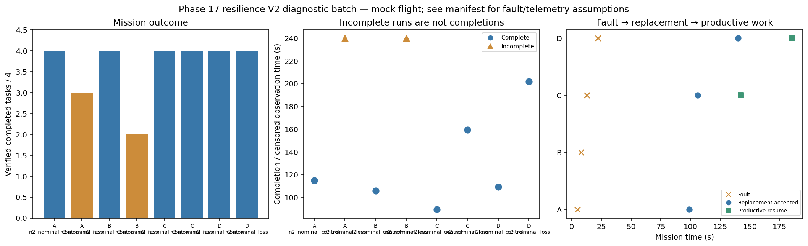

# Phase 17 resilience V2 diagnostic batch

Stage: focused; 8/8 runs; 6 completed missions.
Architectures: A, B, C, D. Each includes a control and a policy-failure case.
Stored size: 5.61 MiB. Fault trigger: owned_motion. Telemetry: alive.

This is a new declared scenario, not final calibration. Replay is not LLM inference. Successful state-triggered recovery does not validate full radio-loss recovery.

B deliberately does not reassign failed-peer tasks. Its incomplete fault outcome is retained, not treated as a technical error. The all-mission diagnostic flag is separate from technical validity.

| Case | Completed tasks | Complete | Time (s) | Replacement accepted at (s) | Productive resume at (s) |
|---|---:|---|---:|---:|---:|
| A_n2_nominal_control_s11 | 4 | True | 114.800083626993 | None | None |
| A_n2_nominal_loss_s11 | 3 | False | 239.8000794579857 | 98.80008831599844 | None |
| B_n2_nominal_control_s11 | 4 | True | 106.00008522599819 | None | None |
| B_n2_nominal_loss_s11 | 2 | False | 239.80008651400567 | None | None |
| C_n2_nominal_control_s11 | 4 | True | 89.40008355001919 | None | None |
| C_n2_nominal_loss_s11 | 4 | True | 159.40008274000138 | 106.00009175998275 | 142.40009018499404 |
| D_n2_nominal_control_s11 | 4 | True | 109.20008540101117 | None | None |
| D_n2_nominal_loss_s11 | 4 | True | 201.80008421099046 | 140.0000929480011 | 185.40009014398674 |

