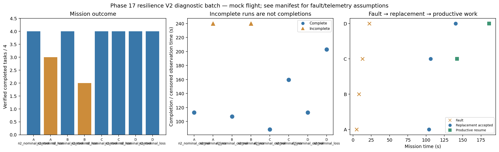

# Phase 17 resilience V2 diagnostic batch

Stage: focused; 8/8 runs; 6 completed missions.
Architectures: A, B, C, D. Each includes a control and a policy-failure case.
Stored size: 5.65 MiB. Fault trigger: owned_motion. Telemetry: alive.

This is a new declared scenario, not final calibration. Replay is not LLM inference. Successful state-triggered recovery does not validate full radio-loss recovery.

B deliberately does not reassign failed-peer tasks. Its incomplete fault outcome is retained, not treated as a technical error. The all-mission diagnostic flag is separate from technical validity.

| Case | Completed tasks | Complete | Time (s) | Replacement accepted at (s) | Productive resume at (s) |
|---|---:|---|---:|---:|---:|
| A_n2_nominal_control_s12 | 4 | True | 113.00010882501374 | None | None |
| A_n2_nominal_loss_s12 | 3 | False | 239.8000834659906 | 104.00008032398182 | None |
| B_n2_nominal_control_s12 | 4 | True | 107.2000882870052 | None | None |
| B_n2_nominal_loss_s12 | 2 | False | 239.80008384300163 | None | None |
| C_n2_nominal_control_s12 | 4 | True | 88.60009049600922 | None | None |
| C_n2_nominal_loss_s12 | 4 | True | 159.60008873499464 | 106.20008860199596 | 142.40009748699958 |
| D_n2_nominal_control_s12 | 4 | True | 112.80008988498594 | None | None |
| D_n2_nominal_loss_s12 | 4 | True | 203.00009923800826 | 140.20008374302415 | 186.20008972802316 |

