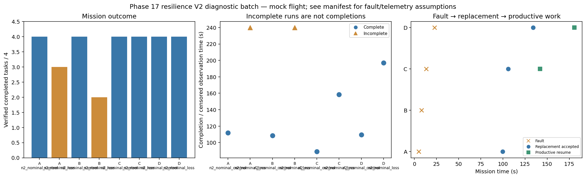

# Phase 17 resilience V2 diagnostic batch

Stage: focused; 8/8 runs; 6 completed missions.
Architectures: A, B, C, D. Each includes a control and a policy-failure case.
Stored size: 5.61 MiB. Fault trigger: owned_motion. Telemetry: alive.

This is a new declared scenario, not final calibration. Replay is not LLM inference. Successful state-triggered recovery does not validate full radio-loss recovery.

B deliberately does not reassign failed-peer tasks. Its incomplete fault outcome is retained, not treated as a technical error. The all-mission diagnostic flag is separate from technical validity.

| Case | Completed tasks | Complete | Time (s) | Replacement accepted at (s) | Productive resume at (s) |
|---|---:|---|---:|---:|---:|
| A_n2_nominal_control_s15 | 4 | True | 112.00008271200932 | None | None |
| A_n2_nominal_loss_s15 | 3 | False | 239.8000877829909 | 99.80008174700197 | None |
| B_n2_nominal_control_s15 | 4 | True | 108.40009468200151 | None | None |
| B_n2_nominal_loss_s15 | 2 | False | 239.80008080700645 | None | None |
| C_n2_nominal_control_s15 | 4 | True | 89.00007402600022 | None | None |
| C_n2_nominal_loss_s15 | 4 | True | 158.60008355398895 | 106.0000886869966 | 141.8000891249976 |
| D_n2_nominal_control_s15 | 4 | True | 109.40007911200519 | None | None |
| D_n2_nominal_loss_s15 | 4 | True | 197.00007988300058 | 134.20009314198978 | 180.80008198600262 |

