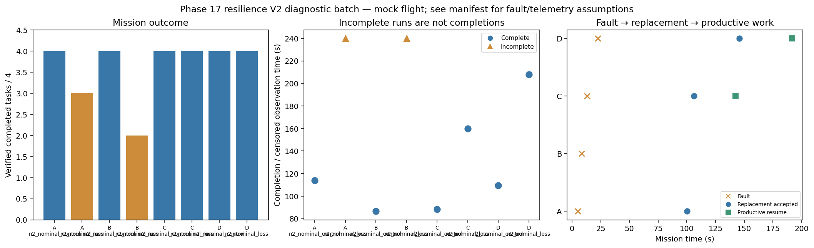

# Phase 17 resilience V2 diagnostic batch

Stage: focused; 8/8 runs; 6 completed missions.
Architectures: A, B, C, D. Each includes a control and a policy-failure case.
Stored size: 5.67 MiB. Fault trigger: owned_motion. Telemetry: alive.

This is a new declared scenario, not final calibration. Replay is not LLM inference. Successful state-triggered recovery does not validate full radio-loss recovery.

B deliberately does not reassign failed-peer tasks. Its incomplete fault outcome is retained, not treated as a technical error. The all-mission diagnostic flag is separate from technical validity.

| Case | Completed tasks | Complete | Time (s) | Replacement accepted at (s) | Productive resume at (s) |
|---|---:|---|---:|---:|---:|
| A_n2_nominal_control_s20 | 4 | True | 113.80012230700231 | None | None |
| A_n2_nominal_loss_s20 | 3 | False | 239.8000810200174 | 100.20009281701641 | None |
| B_n2_nominal_control_s20 | 4 | True | 86.60008098400431 | None | None |
| B_n2_nominal_loss_s20 | 2 | False | 239.80009255299228 | None | None |
| C_n2_nominal_control_s20 | 4 | True | 88.40113846299937 | None | None |
| C_n2_nominal_loss_s20 | 4 | True | 159.800089130993 | 106.2000810529862 | 142.40008289300022 |
| D_n2_nominal_control_s20 | 4 | True | 109.60008505298174 | None | None |
| D_n2_nominal_loss_s20 | 4 | True | 208.00010691399802 | 145.8000798499852 | 191.6000902489759 |

