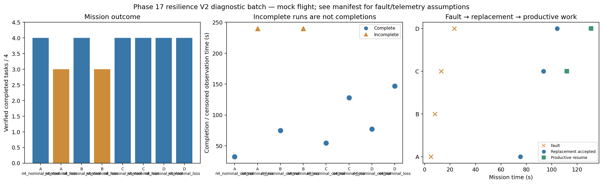

# Phase 17 resilience V2 diagnostic batch

Stage: focused; 8/8 runs; 6 completed missions.
Architectures: A, B, C, D. Each includes a control and a policy-failure case.
Stored size: 10.66 MiB. Fault trigger: owned_motion. Telemetry: alive.

This is a new declared scenario, not final calibration. Replay is not LLM inference. Successful state-triggered recovery does not validate full radio-loss recovery.

B deliberately does not reassign failed-peer tasks. Its incomplete fault outcome is retained, not treated as a technical error. The all-mission diagnostic flag is separate from technical validity.

| Case | Completed tasks | Complete | Time (s) | Replacement accepted at (s) | Productive resume at (s) |
|---|---:|---|---:|---:|---:|
| A_n4_nominal_control_s10 | 4 | True | 32.40008216898423 | None | None |
| A_n4_nominal_loss_s10 | 3 | False | 239.80007922500954 | 75.40008380298968 | None |
| B_n4_nominal_control_s10 | 4 | True | 75.000097740005 | None | None |
| B_n4_nominal_loss_s10 | 3 | False | 239.8000983329839 | None | None |
| C_n4_nominal_control_s10 | 4 | True | 54.60008692200063 | None | None |
| C_n4_nominal_loss_s10 | 4 | True | 128.00007679802366 | 93.60008712200215 | 111.80008243001066 |
| D_n4_nominal_control_s10 | 4 | True | 77.2001030780084 | None | None |
| D_n4_nominal_loss_s10 | 4 | True | 147.00009131600382 | 104.20008399698418 | 131.0000764229917 |

