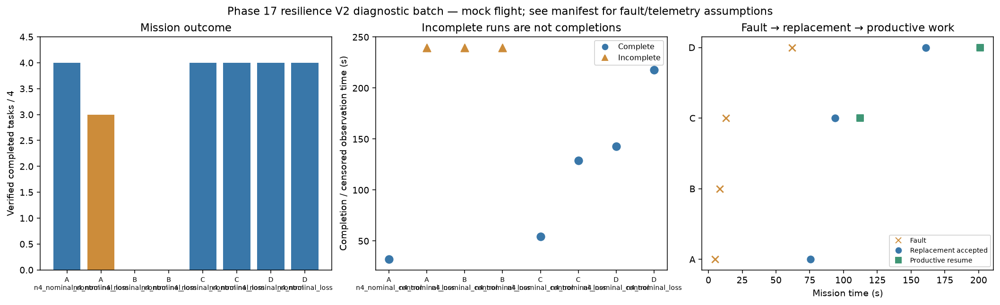

# Phase 17 resilience V2 diagnostic batch

Stage: focused; 8/8 runs; 5 completed missions.
Architectures: A, B, C, D. Each includes a control and a policy-failure case.
Stored size: 11.96 MiB. Fault trigger: owned_motion. Telemetry: alive.

This is a new declared scenario, not final calibration. Replay is not LLM inference. Successful state-triggered recovery does not validate full radio-loss recovery.

B deliberately does not reassign failed-peer tasks. Its incomplete fault outcome is retained, not treated as a technical error. The all-mission diagnostic flag is separate from technical validity.

| Case | Completed tasks | Complete | Time (s) | Replacement accepted at (s) | Productive resume at (s) |
|---|---:|---|---:|---:|---:|
| A_n4_nominal_control_s11 | 4 | True | 32.00009312998736 | None | None |
| A_n4_nominal_loss_s11 | 3 | False | 239.80008495098446 | 75.40008079400286 | None |
| B_n4_nominal_control_s11 | 0 | False | 239.80007794999983 | None | None |
| B_n4_nominal_loss_s11 | 0 | False | 239.8000846520008 | None | None |
| C_n4_nominal_control_s11 | 4 | True | 54.40009157601162 | None | None |
| C_n4_nominal_loss_s11 | 4 | True | 129.0000849989883 | 93.80010536601185 | 112.40008384000976 |
| D_n4_nominal_control_s11 | 4 | True | 142.80009441598668 | None | None |
| D_n4_nominal_loss_s11 | 4 | True | 218.00009287300054 | 161.00010885100346 | 201.20009186002426 |

