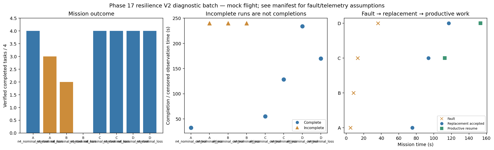

# Phase 17 resilience V2 diagnostic batch

Stage: focused; 8/8 runs; 5 completed missions.
Architectures: A, B, C, D. Each includes a control and a policy-failure case.
Stored size: 13.09 MiB. Fault trigger: owned_motion. Telemetry: alive.

This is a new declared scenario, not final calibration. Replay is not LLM inference. Successful state-triggered recovery does not validate full radio-loss recovery.

B deliberately does not reassign failed-peer tasks. Its incomplete fault outcome is retained, not treated as a technical error. The all-mission diagnostic flag is separate from technical validity.

| Case | Completed tasks | Complete | Time (s) | Replacement accepted at (s) | Productive resume at (s) |
|---|---:|---|---:|---:|---:|
| A_n4_nominal_control_s12 | 4 | True | 32.40022680500988 | None | None |
| A_n4_nominal_loss_s12 | 3 | False | 239.8002180129988 | 75.40022161998786 | None |
| B_n4_nominal_control_s12 | 2 | False | 239.8002201449999 | None | None |
| B_n4_nominal_loss_s12 | 0 | False | 239.80021207401296 | None | None |
| C_n4_nominal_control_s12 | 4 | True | 55.20022410500678 | None | None |
| C_n4_nominal_loss_s12 | 4 | True | 128.60023103500134 | 93.80021981100435 | 112.40006750400062 |
| D_n4_nominal_control_s12 | 4 | True | 233.80023871400044 | None | None |
| D_n4_nominal_loss_s12 | 4 | True | 170.00023406199762 | 117.00005200898158 | 153.20022315398091 |

