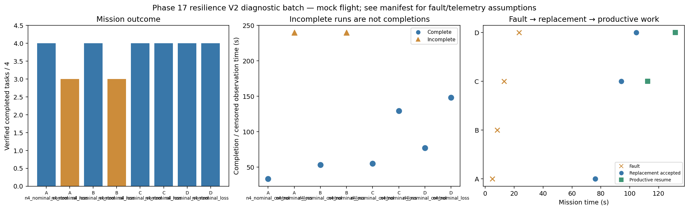

# Phase 17 resilience V2 diagnostic batch

Stage: focused; 8/8 runs; 6 completed missions.
Architectures: A, B, C, D. Each includes a control and a policy-failure case.
Stored size: 10.72 MiB. Fault trigger: owned_motion. Telemetry: alive.

This is a new declared scenario, not final calibration. Replay is not LLM inference. Successful state-triggered recovery does not validate full radio-loss recovery.

B deliberately does not reassign failed-peer tasks. Its incomplete fault outcome is retained, not treated as a technical error. The all-mission diagnostic flag is separate from technical validity.

| Case | Completed tasks | Complete | Time (s) | Replacement accepted at (s) | Productive resume at (s) |
|---|---:|---|---:|---:|---:|
| A_n4_nominal_control_s20 | 4 | True | 33.40011139199487 | None | None |
| A_n4_nominal_loss_s20 | 3 | False | 239.80008881201502 | 76.00008295100997 | None |
| B_n4_nominal_control_s20 | 4 | True | 53.200083523988724 | None | None |
| B_n4_nominal_loss_s20 | 3 | False | 239.80009750797763 | None | None |
| C_n4_nominal_control_s20 | 4 | True | 55.00009364698781 | None | None |
| C_n4_nominal_loss_s20 | 4 | True | 129.60008363300585 | 94.20008536000387 | 112.4000917210069 |
| D_n4_nominal_control_s20 | 4 | True | 77.00013418198796 | None | None |
| D_n4_nominal_loss_s20 | 4 | True | 148.40008272000705 | 104.40012264199322 | 131.60008467399166 |

