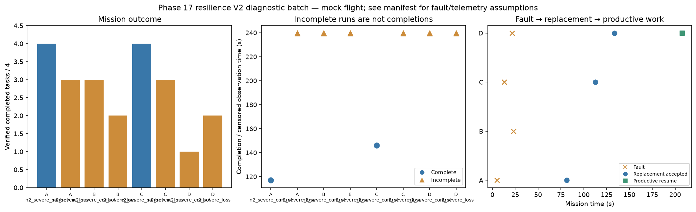

# Phase 17 resilience V2 diagnostic batch

Stage: severe; 8/8 runs; 2 completed missions.
Architectures: A, B, C, D. Each includes a control and a policy-failure case.
Stored size: 7.30 MiB. Fault trigger: owned_motion. Telemetry: alive.

This is a new declared scenario, not final calibration. Replay is not LLM inference. Successful state-triggered recovery does not validate full radio-loss recovery.

B deliberately does not reassign failed-peer tasks. Its incomplete fault outcome is retained, not treated as a technical error. The all-mission diagnostic flag is separate from technical validity.

Normal-operation and recovery-capable checks are reported separately in v2_manifest.json diagnostic_groups. B fault cases are baseline outcomes, not required recovery passes.

| Case | Completed tasks | Complete | Time (s) | Replacement accepted at (s) | Productive resume at (s) |
|---|---:|---|---:|---:|---:|
| A_n2_severe_control_s10 | 4 | True | 117.00008519002586 | None | None |
| A_n2_severe_loss_s10 | 3 | False | 239.80008274299325 | 81.20008887301083 | None |
| B_n2_severe_control_s10 | 3 | False | 239.80009452201193 | None | None |
| B_n2_severe_loss_s10 | 2 | False | 239.80012817899114 | None | None |
| C_n2_severe_control_s10 | 4 | True | 146.00008226500358 | None | None |
| C_n2_severe_loss_s10 | 3 | False | 239.8000797200075 | 112.60007882901118 | None |
| D_n2_severe_control_s10 | 1 | False | 239.80008084399742 | None | None |
| D_n2_severe_loss_s10 | 2 | False | 239.80010575801134 | 133.60008076101076 | 207.80008581199218 |

