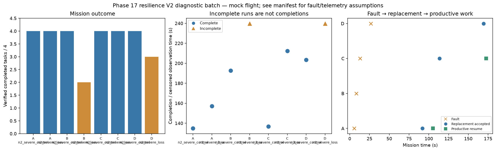

# Phase 17 resilience V2 diagnostic batch

Stage: severe; 8/8 runs; 6 completed missions.
Architectures: A, B, C, D. Each includes a control and a policy-failure case.
Stored size: 7.09 MiB. Fault trigger: owned_motion. Telemetry: alive.

This is a new declared scenario, not final calibration. Replay is not LLM inference. Successful state-triggered recovery does not validate full radio-loss recovery.

B deliberately does not reassign failed-peer tasks. Its incomplete fault outcome is retained, not treated as a technical error. The all-mission diagnostic flag is separate from technical validity.

Normal-operation and recovery-capable checks are reported separately in v2_manifest.json diagnostic_groups. B fault cases are baseline outcomes, not required recovery passes.

| Case | Completed tasks | Complete | Time (s) | Replacement accepted at (s) | Productive resume at (s) |
|---|---:|---|---:|---:|---:|
| A_n2_severe_control_s20 | 4 | True | 134.80008292899583 | None | None |
| A_n2_severe_loss_s20 | 4 | True | 157.0000803899893 | 92.00007687098696 | 105.20009037698037 |
| B_n2_severe_control_s20 | 4 | True | 192.60007918300107 | None | None |
| B_n2_severe_loss_s20 | 2 | False | 239.80008312501013 | None | None |
| C_n2_severe_control_s20 | 4 | True | 136.8000936919998 | None | None |
| C_n2_severe_loss_s20 | 4 | True | 212.40008370400756 | 113.60007966301055 | 172.60007677102112 |
| D_n2_severe_control_s20 | 4 | True | 203.40010115900077 | None | None |
| D_n2_severe_loss_s20 | 3 | False | 239.80007836202276 | 169.20008105001762 | None |

