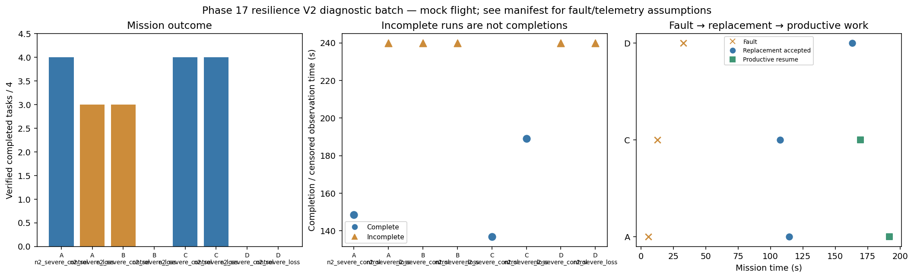

# Phase 17 resilience V2 diagnostic batch

Stage: severe; 8/8 runs; 3 completed missions.
Architectures: A, B, C, D. Each includes a control and a policy-failure case.
Stored size: 7.18 MiB. Fault trigger: owned_motion. Telemetry: alive.

This is a new declared scenario, not final calibration. Replay is not LLM inference. Successful state-triggered recovery does not validate full radio-loss recovery.

B deliberately does not reassign failed-peer tasks. Its incomplete fault outcome is retained, not treated as a technical error. The all-mission diagnostic flag is separate from technical validity.

| Case | Completed tasks | Complete | Time (s) | Replacement accepted at (s) | Productive resume at (s) |
|---|---:|---|---:|---:|---:|
| A_n2_severe_control_s5 | 4 | True | 148.60022322300938 | None | None |
| A_n2_severe_loss_s5 | 3 | False | 239.80023233301472 | 114.4002372190007 | 191.80006373499054 |
| B_n2_severe_control_s5 | 3 | False | 239.80024890598725 | None | None |
| B_n2_severe_loss_s5 | 0 | False | 239.8002362039988 | None | None |
| C_n2_severe_control_s5 | 4 | True | 136.80022808199283 | None | None |
| C_n2_severe_loss_s5 | 4 | True | 189.00023267802317 | 107.40026840101928 | 169.4002357610152 |
| D_n2_severe_control_s5 | 0 | False | 239.80024270899594 | None | None |
| D_n2_severe_loss_s5 | 0 | False | 239.80022946800455 | 163.00024985798518 | None |

