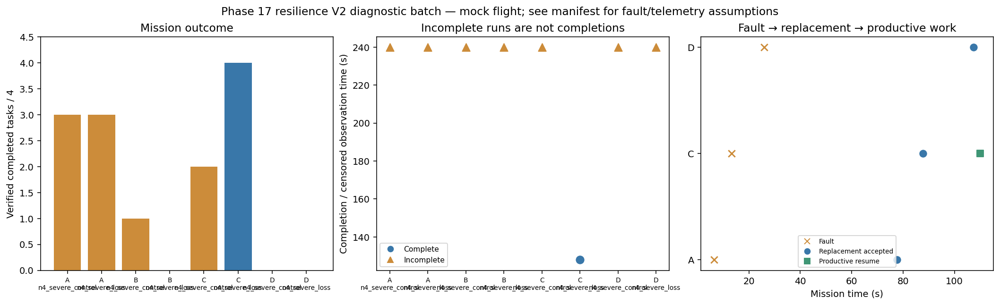

# Phase 17 resilience V2 diagnostic batch

Stage: severe; 8/8 runs; 1 completed missions.
Architectures: A, B, C, D. Each includes a control and a policy-failure case.
Stored size: 21.29 MiB. Fault trigger: owned_motion. Telemetry: alive.

This is a new declared scenario, not final calibration. Replay is not LLM inference. Successful state-triggered recovery does not validate full radio-loss recovery.

B deliberately does not reassign failed-peer tasks. Its incomplete fault outcome is retained, not treated as a technical error. The all-mission diagnostic flag is separate from technical validity.

| Case | Completed tasks | Complete | Time (s) | Replacement accepted at (s) | Productive resume at (s) |
|---|---:|---|---:|---:|---:|
| A_n4_severe_control_s10 | 3 | False | 239.80022603599355 | None | None |
| A_n4_severe_loss_s10 | 3 | False | 239.8002653149888 | 77.60019469898543 | None |
| B_n4_severe_control_s10 | 1 | False | 239.80022738000844 | None | None |
| B_n4_severe_loss_s10 | 0 | False | 239.80025806001504 | None | None |
| C_n4_severe_control_s10 | 2 | False | 239.80021226400277 | None | None |
| C_n4_severe_loss_s10 | 4 | True | 128.00022966999677 | 87.80021928501083 | 110.00022150800214 |
| D_n4_severe_control_s10 | 0 | False | 239.80014026598656 | None | None |
| D_n4_severe_loss_s10 | 0 | False | 239.80023247699137 | 107.40024841399281 | None |

