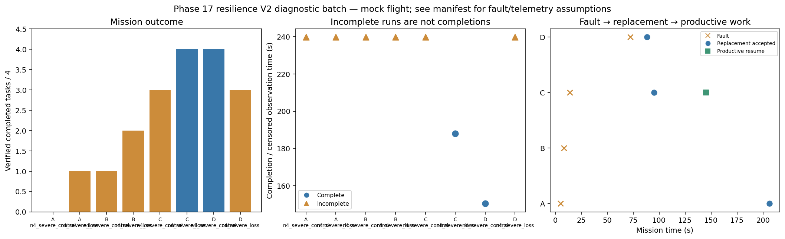

# Phase 17 resilience V2 diagnostic batch

Stage: severe; 8/8 runs; 2 completed missions.
Architectures: A, B, C, D. Each includes a control and a policy-failure case.
Stored size: 20.08 MiB. Fault trigger: owned_motion. Telemetry: alive.

This is a new declared scenario, not final calibration. Replay is not LLM inference. Successful state-triggered recovery does not validate full radio-loss recovery.

B deliberately does not reassign failed-peer tasks. Its incomplete fault outcome is retained, not treated as a technical error. The all-mission diagnostic flag is separate from technical validity.

| Case | Completed tasks | Complete | Time (s) | Replacement accepted at (s) | Productive resume at (s) |
|---|---:|---|---:|---:|---:|
| A_n4_severe_control_s20 | 0 | False | 239.80008141399594 | None | None |
| A_n4_severe_loss_s20 | 1 | False | 239.80008441300015 | 206.20008465100545 | None |
| B_n4_severe_control_s20 | 1 | False | 239.8000869289972 | None | None |
| B_n4_severe_loss_s20 | 2 | False | 239.80008601097506 | None | None |
| C_n4_severe_control_s20 | 3 | False | 239.80007589800516 | None | None |
| C_n4_severe_loss_s20 | 4 | True | 188.00007961099618 | 95.20009260199731 | 145.20009025000036 |
| D_n4_severe_control_s20 | 4 | True | 150.40007985499687 | None | None |
| D_n4_severe_loss_s20 | 3 | False | 239.8000830099918 | 88.20009534998098 | None |

