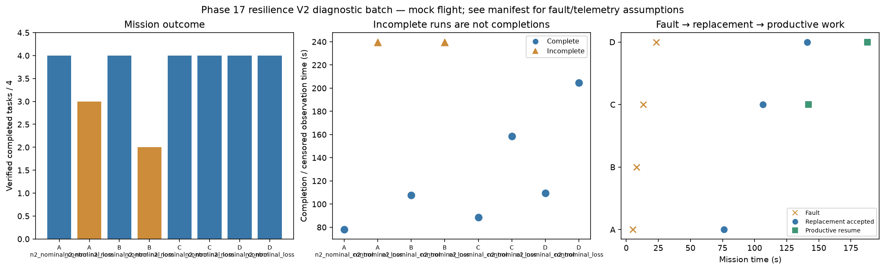

# Phase 17 resilience V2 diagnostic batch

Stage: focused; 8/8 runs; 6 completed missions.
Architectures: A, B, C, D. Each includes a control and a policy-failure case.
Stored size: 5.56 MiB. Fault trigger: owned_motion. Telemetry: alive.

This is a new declared scenario, not final calibration. Replay is not LLM inference. Successful state-triggered recovery does not validate full radio-loss recovery.

B deliberately does not reassign failed-peer tasks. Its incomplete fault outcome is retained, not treated as a technical error. The all-mission diagnostic flag is separate from technical validity.

Normal-operation and recovery-capable checks are reported separately in v2_manifest.json diagnostic_groups. B fault cases are baseline outcomes, not required recovery passes.

| Case | Completed tasks | Complete | Time (s) | Replacement accepted at (s) | Productive resume at (s) |
|---|---:|---|---:|---:|---:|
| A_n2_nominal_control_s11 | 4 | True | 78.00008218601579 | None | None |
| A_n2_nominal_loss_s11 | 3 | False | 239.80008646697388 | 76.00009269799921 | None |
| B_n2_nominal_control_s11 | 4 | True | 107.60008321100031 | None | None |
| B_n2_nominal_loss_s11 | 2 | False | 239.80007882000064 | None | None |
| C_n2_nominal_control_s11 | 4 | True | 88.40008078399114 | None | None |
| C_n2_nominal_loss_s11 | 4 | True | 158.40012206300162 | 106.40007078400231 | 141.80008810799336 |
| D_n2_nominal_control_s11 | 4 | True | 109.60009126598015 | None | None |
| D_n2_nominal_loss_s11 | 4 | True | 204.8000864519854 | 141.0000985969964 | 188.00008118897676 |

