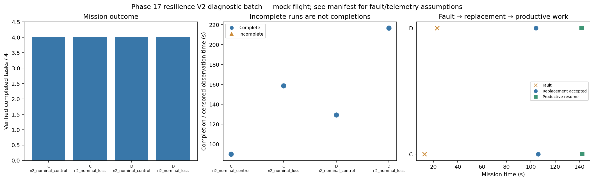

# Phase 17 resilience V2 diagnostic batch

Stage: focused; 4/4 runs; 4 completed missions.
Stored size: 2.64 MiB. Fault trigger: owned_motion. Telemetry: alive.

This is a new declared scenario, not final calibration. Replay is not LLM inference. Successful state-triggered recovery does not validate full radio-loss recovery.

| Case | Completed tasks | Complete | Time (s) | Replacement accepted at (s) | Productive resume at (s) |
|---|---:|---|---:|---:|---:|
| C_n2_nominal_control_s11 | 4 | True | 89.80023557100503 | None | None |
| C_n2_nominal_loss_s11 | 4 | True | 158.6002408249915 | 106.0002510129998 | 142.2002351229894 |
| D_n2_nominal_control_s11 | 4 | True | 129.4002517619956 | None | None |
| D_n2_nominal_loss_s11 | 4 | True | 216.60023999100667 | 104.20023691600363 | 141.80023568500474 |

