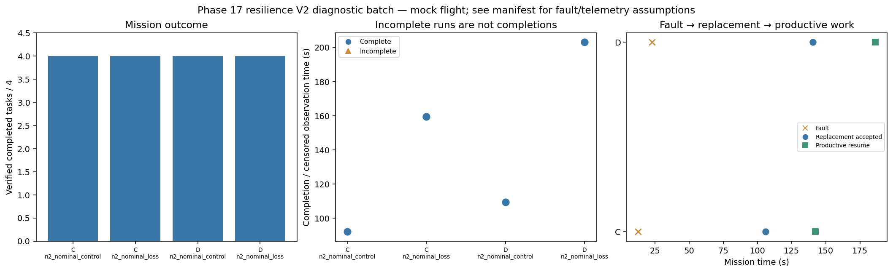

# Phase 17 resilience V2 diagnostic batch

Stage: focused; 4/4 runs; 4 completed missions.
Stored size: 2.61 MiB. Fault trigger: owned_motion. Telemetry: alive.

This is a new declared scenario, not final calibration. Replay is not LLM inference. Successful state-triggered recovery does not validate full radio-loss recovery.

| Case | Completed tasks | Complete | Time (s) | Replacement accepted at (s) | Productive resume at (s) |
|---|---:|---|---:|---:|---:|
| C_n2_nominal_control_s12 | 4 | True | 92.20022760200663 | None | None |
| C_n2_nominal_loss_s12 | 4 | True | 159.40023533499334 | 106.00006378600665 | 142.40007253500517 |
| D_n2_nominal_control_s12 | 4 | True | 109.600180843001 | None | None |
| D_n2_nominal_loss_s12 | 4 | True | 203.0002276909945 | 140.40023569299956 | 186.20023795399175 |

