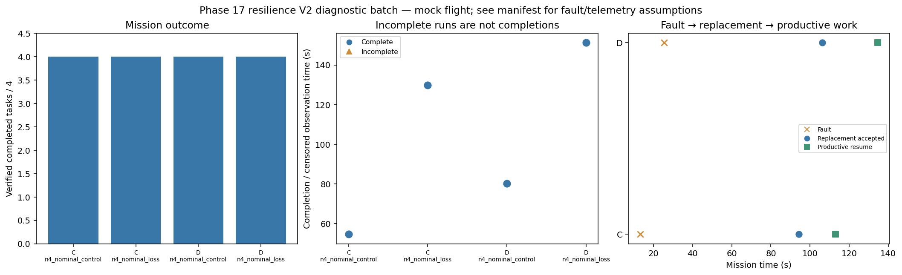

# Phase 17 resilience V2 diagnostic batch

Stage: focused; 4/4 runs; 4 completed missions.
Stored size: 4.91 MiB. Fault trigger: owned_motion. Telemetry: alive.

This is a new declared scenario, not final calibration. Replay is not LLM inference. Successful state-triggered recovery does not validate full radio-loss recovery.

| Case | Completed tasks | Complete | Time (s) | Replacement accepted at (s) | Productive resume at (s) |
|---|---:|---|---:|---:|---:|
| C_n4_nominal_control_s11 | 4 | True | 54.60023185900354 | None | None |
| C_n4_nominal_loss_s11 | 4 | True | 129.80021860399575 | 94.20025283799623 | 113.00022903899662 |
| D_n4_nominal_control_s11 | 4 | True | 80.20022116899781 | None | None |
| D_n4_nominal_loss_s11 | 4 | True | 151.20023098299862 | 106.20023071600008 | 134.60023594700033 |

