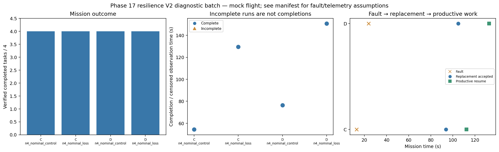

# Phase 17 resilience V2 diagnostic batch

Stage: focused; 4/4 runs; 4 completed missions.
Stored size: 4.88 MiB. Fault trigger: owned_motion. Telemetry: alive.

This is a new declared scenario, not final calibration. Replay is not LLM inference. Successful state-triggered recovery does not validate full radio-loss recovery.

| Case | Completed tasks | Complete | Time (s) | Replacement accepted at (s) | Productive resume at (s) |
|---|---:|---|---:|---:|---:|
| C_n4_nominal_control_s12 | 4 | True | 54.40024381100375 | None | None |
| C_n4_nominal_loss_s12 | 4 | True | 129.60023279499728 | 93.80022508600086 | 112.20023372099968 |
| D_n4_nominal_control_s12 | 4 | True | 76.40012997399026 | None | None |
| D_n4_nominal_loss_s12 | 4 | True | 150.60022791600204 | 104.80024531201343 | 132.80021970400412 |

