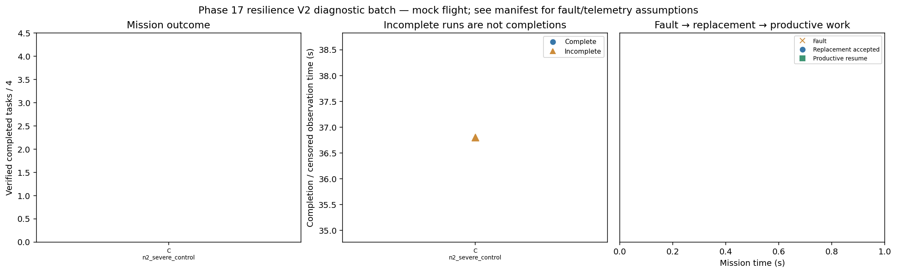

# Phase 17 resilience V2 diagnostic batch

Stage: severe; 1/4 runs; 0 completed missions.
Stored size: 0.57 MiB. Fault trigger: owned_motion. Telemetry: alive.

This is a new declared scenario, not final calibration. Replay is not LLM inference. Successful state-triggered recovery does not validate full radio-loss recovery.

| Case | Completed tasks | Complete | Time (s) | Replacement accepted at (s) | Productive resume at (s) |
|---|---:|---|---:|---:|---:|
| C_n2_severe_control_s11 | 0 | False | 36.800174488002085 | None | None |

