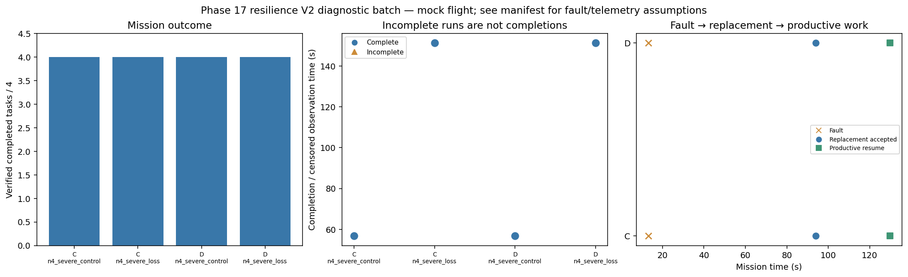

# Phase 17 resilience V2 diagnostic batch

Stage: severe; 4/4 runs; 4 completed missions.
Stored size: 5.31 MiB. Fault trigger: owned_motion. Telemetry: alive.

This is a new declared scenario, not final calibration. Replay is not LLM inference. Successful state-triggered recovery does not validate full radio-loss recovery.

| Case | Completed tasks | Complete | Time (s) | Replacement accepted at (s) | Productive resume at (s) |
|---|---:|---|---:|---:|---:|
| C_n4_severe_control_s8 | 4 | True | 56.8 | None | None |
| C_n4_severe_loss_s8 | 4 | True | 151.2 | 94.0 | 129.8 |
| D_n4_severe_control_s8 | 4 | True | 56.8 | None | None |
| D_n4_severe_loss_s8 | 4 | True | 151.2 | 94.0 | 129.8 |

