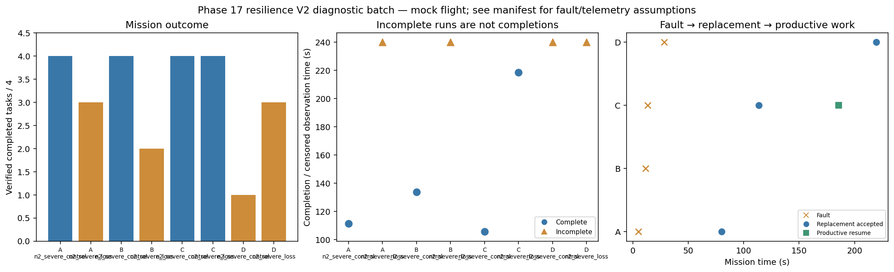

# Phase 17 resilience V2 diagnostic batch

Stage: severe; 8/8 runs; 4 completed missions.
Architectures: A, B, C, D. Each includes a control and a policy-failure case.
Stored size: 6.92 MiB. Fault trigger: owned_motion. Telemetry: alive.

This is a new declared scenario, not final calibration. Replay is not LLM inference. Successful state-triggered recovery does not validate full radio-loss recovery.

B deliberately does not reassign failed-peer tasks. Its incomplete fault outcome is retained, not treated as a technical error. The all-mission diagnostic flag is separate from technical validity.

Normal-operation and recovery-capable checks are reported separately in v2_manifest.json diagnostic_groups. B fault cases are baseline outcomes, not required recovery passes.

| Case | Completed tasks | Complete | Time (s) | Replacement accepted at (s) | Productive resume at (s) |
|---|---:|---|---:|---:|---:|
| A_n2_severe_control_s10 | 4 | True | 111.4002772559179 | None | None |
| A_n2_severe_loss_s10 | 3 | False | 239.8003068419639 | 80.20027837902308 | None |
| B_n2_severe_control_s10 | 4 | True | 133.8002930150833 | None | None |
| B_n2_severe_loss_s10 | 2 | False | 239.8002791570034 | None | None |
| C_n2_severe_control_s10 | 4 | True | 105.60028553789016 | None | None |
| C_n2_severe_loss_s10 | 4 | True | 218.40026261401363 | 113.60027453291696 | 185.80028273700736 |
| D_n2_severe_control_s10 | 1 | False | 239.80022433190607 | None | None |
| D_n2_severe_loss_s10 | 3 | False | 239.80028175597545 | 219.60028790100478 | None |

