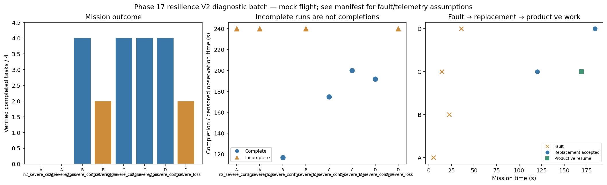

# Phase 17 resilience V2 diagnostic batch

Stage: severe; 8/8 runs; 4 completed missions.
Architectures: A, B, C, D. Each includes a control and a policy-failure case.
Stored size: 6.99 MiB. Fault trigger: owned_motion. Telemetry: alive.

This is a new declared scenario, not final calibration. Replay is not LLM inference. Successful state-triggered recovery does not validate full radio-loss recovery.

B deliberately does not reassign failed-peer tasks. Its incomplete fault outcome is retained, not treated as a technical error. The all-mission diagnostic flag is separate from technical validity.

Normal-operation and recovery-capable checks are reported separately in v2_manifest.json diagnostic_groups. B fault cases are baseline outcomes, not required recovery passes.

| Case | Completed tasks | Complete | Time (s) | Replacement accepted at (s) | Productive resume at (s) |
|---|---:|---|---:|---:|---:|
| A_n2_severe_control_s12 | 0 | False | 239.8002997210715 | None | None |
| A_n2_severe_loss_s12 | 0 | False | 239.800295552006 | None | None |
| B_n2_severe_control_s12 | 4 | True | 116.80026859801728 | None | None |
| B_n2_severe_loss_s12 | 2 | False | 239.80026278400328 | None | None |
| C_n2_severe_control_s12 | 4 | True | 174.8002707529813 | None | None |
| C_n2_severe_loss_s12 | 4 | True | 200.0002537020482 | 120.20026569603942 | 169.00028372905217 |
| D_n2_severe_control_s12 | 4 | True | 191.80028394400142 | None | None |
| D_n2_severe_loss_s12 | 2 | False | 239.80026806110982 | 184.00029682705645 | None |

