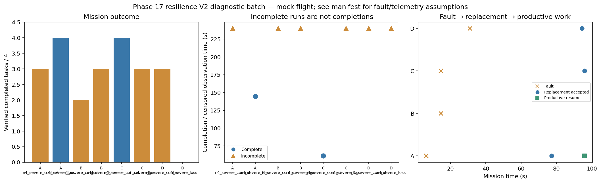

# Phase 17 resilience V2 diagnostic batch

Stage: severe; 8/8 runs; 2 completed missions.
Architectures: A, B, C, D. Each includes a control and a policy-failure case.
Stored size: 18.79 MiB. Fault trigger: owned_motion. Telemetry: alive.

This is a new declared scenario, not final calibration. Replay is not LLM inference. Successful state-triggered recovery does not validate full radio-loss recovery.

B deliberately does not reassign failed-peer tasks. Its incomplete fault outcome is retained, not treated as a technical error. The all-mission diagnostic flag is separate from technical validity.

Normal-operation and recovery-capable checks are reported separately in v2_manifest.json diagnostic_groups. B fault cases are baseline outcomes, not required recovery passes.

| Case | Completed tasks | Complete | Time (s) | Replacement accepted at (s) | Productive resume at (s) |
|---|---:|---|---:|---:|---:|
| A_n4_severe_control_s13 | 3 | False | 239.80027288210113 | None | None |
| A_n4_severe_loss_s13 | 4 | True | 144.6002483149059 | 77.20028271200135 | 95.80021177593153 |
| B_n4_severe_control_s13 | 2 | False | 239.80028430302627 | None | None |
| B_n4_severe_loss_s13 | 3 | False | 239.8002557370346 | None | None |
| C_n4_severe_control_s13 | 4 | True | 61.20027867297176 | None | None |
| C_n4_severe_loss_s13 | 3 | False | 239.8002848709002 | 95.80027577199508 | None |
| D_n4_severe_control_s13 | 3 | False | 239.8002491509542 | None | None |
| D_n4_severe_loss_s13 | 0 | False | 239.8002609560499 | 94.40022760105785 | None |

