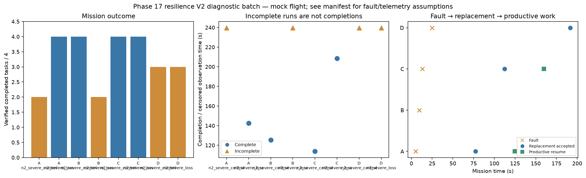

# Phase 17 resilience V2 diagnostic batch

Stage: severe; 8/8 runs; 4 completed missions.
Architectures: A, B, C, D. Each includes a control and a policy-failure case.
Stored size: 7.13 MiB. Fault trigger: owned_motion. Telemetry: alive.

This is a new declared scenario, not final calibration. Replay is not LLM inference. Successful state-triggered recovery does not validate full radio-loss recovery.

B deliberately does not reassign failed-peer tasks. Its incomplete fault outcome is retained, not treated as a technical error. The all-mission diagnostic flag is separate from technical validity.

Normal-operation and recovery-capable checks are reported separately in v2_manifest.json diagnostic_groups. B fault cases are baseline outcomes, not required recovery passes.

| Case | Completed tasks | Complete | Time (s) | Replacement accepted at (s) | Productive resume at (s) |
|---|---:|---|---:|---:|---:|
| A_n2_severe_control_s11 | 2 | False | 239.80008807600825 | None | None |
| A_n2_severe_loss_s11 | 4 | True | 142.60008780201315 | 77.4000814910105 | 124.80008429900045 |
| B_n2_severe_control_s11 | 4 | True | 125.40007976500783 | None | None |
| B_n2_severe_loss_s11 | 2 | False | 239.80007942399243 | None | None |
| C_n2_severe_control_s11 | 4 | True | 113.80008596699918 | None | None |
| C_n2_severe_loss_s11 | 4 | True | 208.60007960998337 | 112.40009112798725 | 159.8000980579818 |
| D_n2_severe_control_s11 | 3 | False | 239.80009986000368 | None | None |
| D_n2_severe_loss_s11 | 3 | False | 239.8000810710073 | 191.60009295100463 | None |

