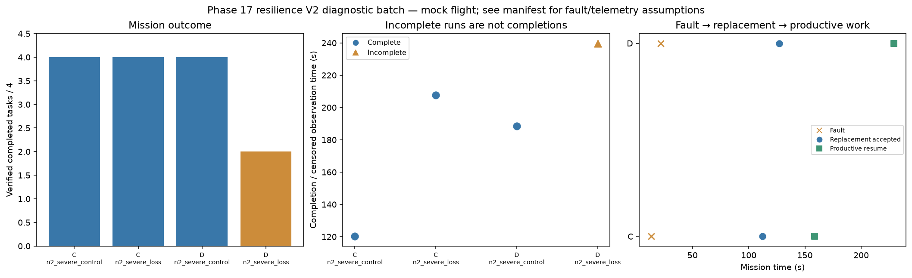

# Phase 17 resilience V2 diagnostic batch

Stage: severe; 4/4 runs; 3 completed missions.
Architectures: C, D. Each includes a control and a policy-failure case.
Stored size: 3.25 MiB. Fault trigger: owned_motion. Telemetry: alive.

This is a new declared scenario, not final calibration. Replay is not LLM inference. Successful state-triggered recovery does not validate full radio-loss recovery.

B deliberately does not reassign failed-peer tasks. Its incomplete fault outcome is retained, not treated as a technical error. The all-mission diagnostic flag is separate from technical validity.

Normal-operation and recovery-capable checks are reported separately in v2_manifest.json diagnostic_groups. B fault cases are baseline outcomes, not required recovery passes.

| Case | Completed tasks | Complete | Time (s) | Replacement accepted at (s) | Productive resume at (s) |
|---|---:|---|---:|---:|---:|
| C_n2_severe_control_s10 | 4 | True | 120.20008109003538 | None | None |
| C_n2_severe_loss_s10 | 4 | True | 207.60008302796632 | 112.20008051698096 | 158.6000763209886 |
| D_n2_severe_control_s10 | 4 | True | 188.60012144898064 | None | None |
| D_n2_severe_loss_s10 | 2 | False | 239.80014898703666 | 127.2000965620391 | 229.20008778903866 |

