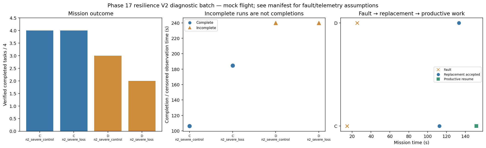

# Phase 17 resilience V2 diagnostic batch

Stage: severe; 4/4 runs; 2 completed missions.
Architectures: C, D. Each includes a control and a policy-failure case.
Stored size: 3.17 MiB. Fault trigger: owned_motion. Telemetry: alive.

This is a new declared scenario, not final calibration. Replay is not LLM inference. Successful state-triggered recovery does not validate full radio-loss recovery.

B deliberately does not reassign failed-peer tasks. Its incomplete fault outcome is retained, not treated as a technical error. The all-mission diagnostic flag is separate from technical validity.

Normal-operation and recovery-capable checks are reported separately in v2_manifest.json diagnostic_groups. B fault cases are baseline outcomes, not required recovery passes.

| Case | Completed tasks | Complete | Time (s) | Replacement accepted at (s) | Productive resume at (s) |
|---|---:|---|---:|---:|---:|
| C_n2_severe_control_s15 | 4 | True | 106.20028549409471 | None | None |
| C_n2_severe_loss_s15 | 4 | True | 184.8001150659984 | 112.40026789600961 | 151.6002797849942 |
| D_n2_severe_control_s15 | 3 | False | 239.80027233995497 | None | None |
| D_n2_severe_loss_s15 | 2 | False | 239.8002955459524 | 133.00029391399585 | None |

