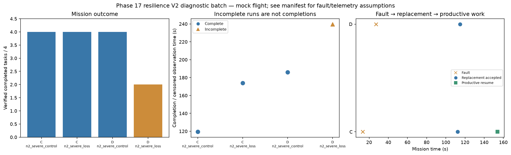

# Phase 17 resilience V2 diagnostic batch

Stage: severe; 4/4 runs; 3 completed missions.
Architectures: C, D. Each includes a control and a policy-failure case.
Stored size: 3.23 MiB. Fault trigger: owned_motion. Telemetry: alive.

This is a new declared scenario, not final calibration. Replay is not LLM inference. Successful state-triggered recovery does not validate full radio-loss recovery.

B deliberately does not reassign failed-peer tasks. Its incomplete fault outcome is retained, not treated as a technical error. The all-mission diagnostic flag is separate from technical validity.

Normal-operation and recovery-capable checks are reported separately in v2_manifest.json diagnostic_groups. B fault cases are baseline outcomes, not required recovery passes.

| Case | Completed tasks | Complete | Time (s) | Replacement accepted at (s) | Productive resume at (s) |
|---|---:|---|---:|---:|---:|
| C_n2_severe_control_s20 | 4 | True | 119.40009814704536 | None | None |
| C_n2_severe_loss_s20 | 4 | True | 174.00008225999773 | 112.40004499000497 | 154.00006118201418 |
| D_n2_severe_control_s20 | 4 | True | 186.00007948698476 | None | None |
| D_n2_severe_loss_s20 | 2 | False | 239.8000812040409 | 114.80008774599992 | None |

