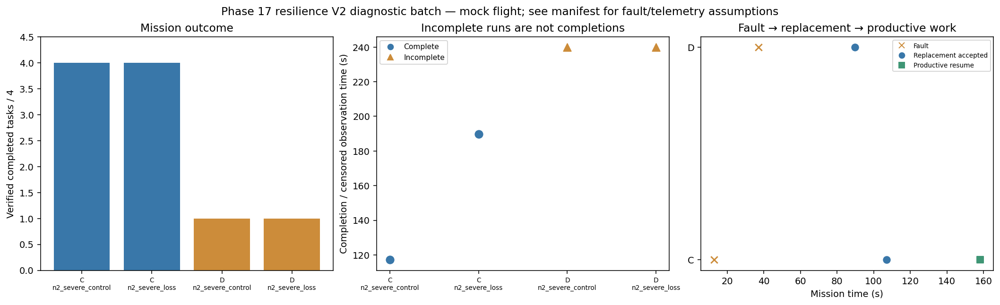

# Phase 17 resilience V2 diagnostic batch

Stage: severe; 4/4 runs; 2 completed missions.
Architectures: C, D. Each includes a control and a policy-failure case.
Stored size: 3.07 MiB. Fault trigger: owned_motion. Telemetry: alive.

This is a new declared scenario, not final calibration. Replay is not LLM inference. Successful state-triggered recovery does not validate full radio-loss recovery.

B deliberately does not reassign failed-peer tasks. Its incomplete fault outcome is retained, not treated as a technical error. The all-mission diagnostic flag is separate from technical validity.

Normal-operation and recovery-capable checks are reported separately in v2_manifest.json diagnostic_groups. B fault cases are baseline outcomes, not required recovery passes.

| Case | Completed tasks | Complete | Time (s) | Replacement accepted at (s) | Productive resume at (s) |
|---|---:|---|---:|---:|---:|
| C_n2_severe_control_s5 | 4 | True | 117.2002822260838 | None | None |
| C_n2_severe_loss_s5 | 4 | True | 189.80031138600316 | 107.00028829998337 | 158.2002909469884 |
| D_n2_severe_control_s5 | 1 | False | 239.80028769304045 | None | None |
| D_n2_severe_loss_s5 | 1 | False | 239.80025104398374 | 89.80027678294573 | None |

