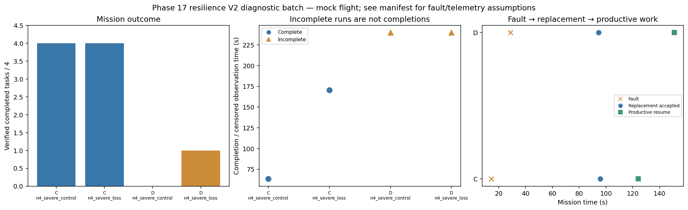

# Phase 17 resilience V2 diagnostic batch

Stage: severe; 4/4 runs; 2 completed missions.
Architectures: C, D. Each includes a control and a policy-failure case.
Stored size: 7.66 MiB. Fault trigger: owned_motion. Telemetry: alive.

This is a new declared scenario, not final calibration. Replay is not LLM inference. Successful state-triggered recovery does not validate full radio-loss recovery.

B deliberately does not reassign failed-peer tasks. Its incomplete fault outcome is retained, not treated as a technical error. The all-mission diagnostic flag is separate from technical validity.

Normal-operation and recovery-capable checks are reported separately in v2_manifest.json diagnostic_groups. B fault cases are baseline outcomes, not required recovery passes.

| Case | Completed tasks | Complete | Time (s) | Replacement accepted at (s) | Productive resume at (s) |
|---|---:|---|---:|---:|---:|
| C_n4_severe_control_s20 | 4 | True | 63.40028577798512 | None | None |
| C_n4_severe_loss_s20 | 4 | True | 170.6002504050266 | 95.60026356601156 | 124.0002840369707 |
| D_n4_severe_control_s20 | 0 | False | 239.80025008006487 | None | None |
| D_n4_severe_loss_s20 | 1 | False | 239.8002739190124 | 94.40019701095298 | 151.00026706699282 |

