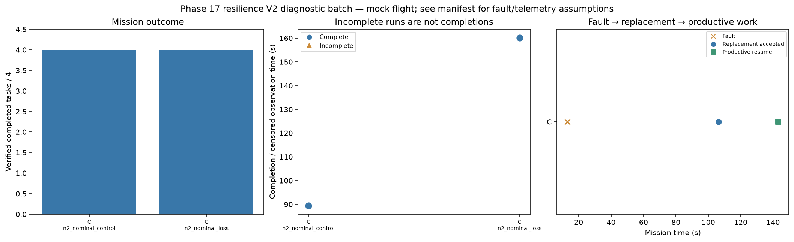

# Phase 17 resilience V2 diagnostic batch

Stage: focused; 2/2 runs; 2 completed missions.
Architectures: C. Each includes a control and a policy-failure case.
Stored size: 1.32 MiB. Fault trigger: owned_motion. Telemetry: alive.

This is a new declared scenario, not final calibration. Replay is not LLM inference. Successful state-triggered recovery does not validate full radio-loss recovery.

B deliberately does not reassign failed-peer tasks. Its incomplete fault outcome is retained, not treated as a technical error. The all-mission diagnostic flag is separate from technical validity.

Normal-operation and recovery-capable checks are reported separately in v2_manifest.json diagnostic_groups. B fault cases are baseline outcomes, not required recovery passes.

| Case | Completed tasks | Complete | Time (s) | Replacement accepted at (s) | Productive resume at (s) |
|---|---:|---|---:|---:|---:|
| C_n2_nominal_control_s10 | 4 | True | 89.40009199499036 | None | None |
| C_n2_nominal_loss_s10 | 4 | True | 160.20008590299403 | 106.40008903600392 | 143.20009222399676 |

