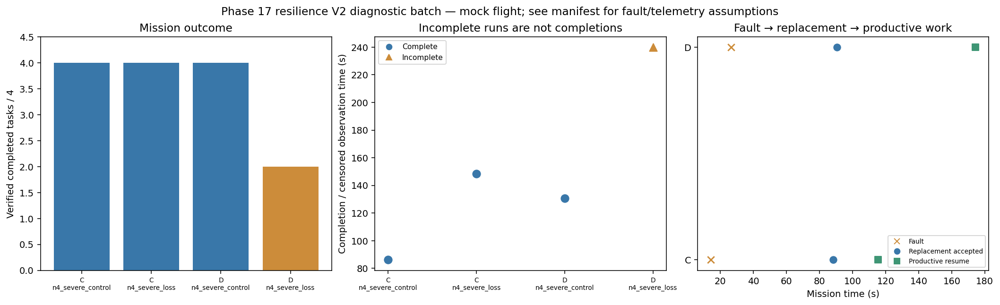

# Phase 17 resilience V2 diagnostic batch

Stage: severe; 4/4 runs; 3 completed missions.
Architectures: C, D. Each includes a control and a policy-failure case.
Stored size: 7.31 MiB. Fault trigger: owned_motion. Telemetry: alive.

This is a new declared scenario, not final calibration. Replay is not LLM inference. Successful state-triggered recovery does not validate full radio-loss recovery.

B deliberately does not reassign failed-peer tasks. Its incomplete fault outcome is retained, not treated as a technical error. The all-mission diagnostic flag is separate from technical validity.

Normal-operation and recovery-capable checks are reported separately in v2_manifest.json diagnostic_groups. B fault cases are baseline outcomes, not required recovery passes.

| Case | Completed tasks | Complete | Time (s) | Replacement accepted at (s) | Productive resume at (s) |
|---|---:|---|---:|---:|---:|
| C_n4_severe_control_s15 | 4 | True | 86.20023809801205 | None | None |
| C_n4_severe_loss_s15 | 4 | True | 148.40021965597407 | 88.20020839298377 | 115.40022455897997 |
| D_n4_severe_control_s15 | 4 | True | 130.80024024599697 | None | None |
| D_n4_severe_loss_s15 | 2 | False | 239.8002539089939 | 90.60022553498857 | 174.40023645598558 |

