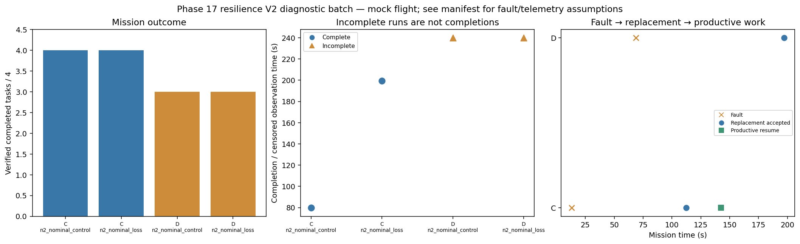

# Phase 17 resilience V2 diagnostic batch

Stage: focused; 4/4 runs; 2 completed missions.
Stored size: 2.70 MiB. Fault trigger: owned_motion. Telemetry: alive.

This is a new declared scenario, not final calibration. Replay is not LLM inference. Successful state-triggered recovery does not validate full radio-loss recovery.

| Case | Completed tasks | Complete | Time (s) | Replacement accepted at (s) | Productive resume at (s) |
|---|---:|---|---:|---:|---:|
| C_n2_nominal_control_s7 | 4 | True | 79.80028426495846 | None | None |
| C_n2_nominal_loss_s7 | 4 | True | 199.400087187998 | 112.40009429003112 | 142.40009026706684 |
| D_n2_nominal_control_s7 | 3 | False | 239.8000841010362 | None | None |
| D_n2_nominal_loss_s7 | 3 | False | 239.8001081100665 | 197.20009541104082 | None |

