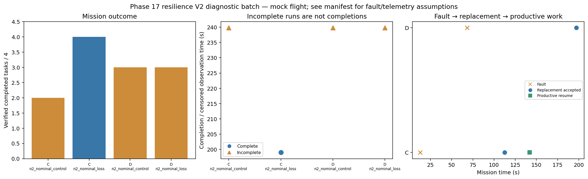

# Phase 17 resilience V2 diagnostic batch

Stage: focused; 4/4 runs; 1 completed missions.
Stored size: 3.01 MiB. Fault trigger: owned_motion. Telemetry: alive.

This is a new declared scenario, not final calibration. Replay is not LLM inference. Successful state-triggered recovery does not validate full radio-loss recovery.

| Case | Completed tasks | Complete | Time (s) | Replacement accepted at (s) | Productive resume at (s) |
|---|---:|---|---:|---:|---:|
| C_n2_nominal_control_s8 | 2 | False | 239.8002137360163 | None | None |
| C_n2_nominal_loss_s8 | 4 | True | 199.0000836380059 | 112.40008386108093 | 142.20010647410527 |
| D_n2_nominal_control_s8 | 3 | False | 239.80010819400195 | None | None |
| D_n2_nominal_loss_s8 | 3 | False | 239.80008906696457 | 197.2000914629316 | None |

