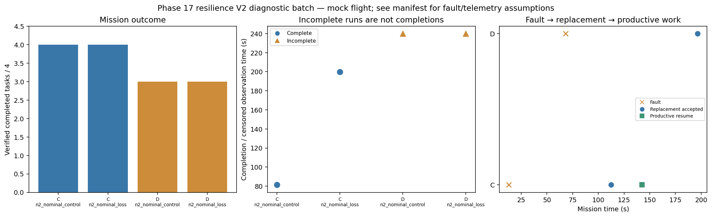

# Phase 17 resilience V2 diagnostic batch

Stage: focused; 4/4 runs; 2 completed missions.
Stored size: 2.70 MiB. Fault trigger: owned_motion. Telemetry: alive.

This is a new declared scenario, not final calibration. Replay is not LLM inference. Successful state-triggered recovery does not validate full radio-loss recovery.

| Case | Completed tasks | Complete | Time (s) | Replacement accepted at (s) | Productive resume at (s) |
|---|---:|---|---:|---:|---:|
| C_n2_nominal_control_s9 | 4 | True | 81.40004943998065 | None | None |
| C_n2_nominal_loss_s9 | 4 | True | 199.80008640303276 | 112.40008102997672 | 142.40009333204944 |
| D_n2_nominal_control_s9 | 3 | False | 239.80052119598258 | None | None |
| D_n2_nominal_loss_s9 | 3 | False | 239.80008529301267 | 196.6000877909828 | None |

