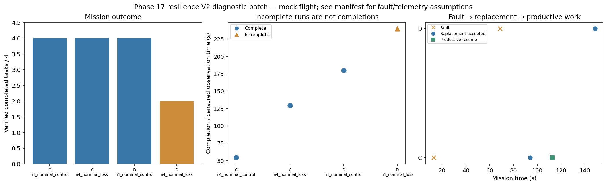

# Phase 17 resilience V2 diagnostic batch

Stage: focused; 4/4 runs; 3 completed missions.
Stored size: 5.94 MiB. Fault trigger: owned_motion. Telemetry: alive.

This is a new declared scenario, not final calibration. Replay is not LLM inference. Successful state-triggered recovery does not validate full radio-loss recovery.

| Case | Completed tasks | Complete | Time (s) | Replacement accepted at (s) | Productive resume at (s) |
|---|---:|---|---:|---:|---:|
| C_n4_nominal_control_s7 | 4 | True | 54.400096949073486 | None | None |
| C_n4_nominal_loss_s7 | 4 | True | 129.60012715205085 | 93.80009109596722 | 112.40029199502897 |
| D_n4_nominal_control_s7 | 4 | True | 179.800091683981 | None | None |
| D_n4_nominal_loss_s7 | 2 | False | 239.80009700998198 | 148.40008673199918 | None |

