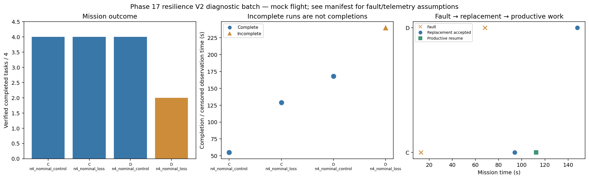

# Phase 17 resilience V2 diagnostic batch

Stage: focused; 4/4 runs; 3 completed missions.
Stored size: 5.83 MiB. Fault trigger: owned_motion. Telemetry: alive.

This is a new declared scenario, not final calibration. Replay is not LLM inference. Successful state-triggered recovery does not validate full radio-loss recovery.

| Case | Completed tasks | Complete | Time (s) | Replacement accepted at (s) | Productive resume at (s) |
|---|---:|---|---:|---:|---:|
| C_n4_nominal_control_s8 | 4 | True | 55.00008942198474 | None | None |
| C_n4_nominal_loss_s8 | 4 | True | 129.20008566905744 | 94.00009299605154 | 112.40008768311236 |
| D_n4_nominal_control_s8 | 4 | True | 168.2002047279384 | None | None |
| D_n4_nominal_loss_s8 | 2 | False | 239.80030887795147 | 148.0000905470224 | None |

