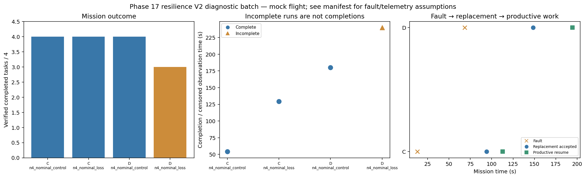

# Phase 17 resilience V2 diagnostic batch

Stage: focused; 4/4 runs; 3 completed missions.
Stored size: 5.90 MiB. Fault trigger: owned_motion. Telemetry: alive.

This is a new declared scenario, not final calibration. Replay is not LLM inference. Successful state-triggered recovery does not validate full radio-loss recovery.

| Case | Completed tasks | Complete | Time (s) | Replacement accepted at (s) | Productive resume at (s) |
|---|---:|---|---:|---:|---:|
| C_n4_nominal_control_s9 | 4 | True | 54.200097489054315 | None | None |
| C_n4_nominal_loss_s9 | 4 | True | 129.20009099994786 | 94.00009579397738 | 112.80011834902689 |
| D_n4_nominal_control_s9 | 4 | True | 180.00008442101534 | None | None |
| D_n4_nominal_loss_s9 | 3 | False | 239.80009836901445 | 148.4000995940296 | 194.40009175799787 |

