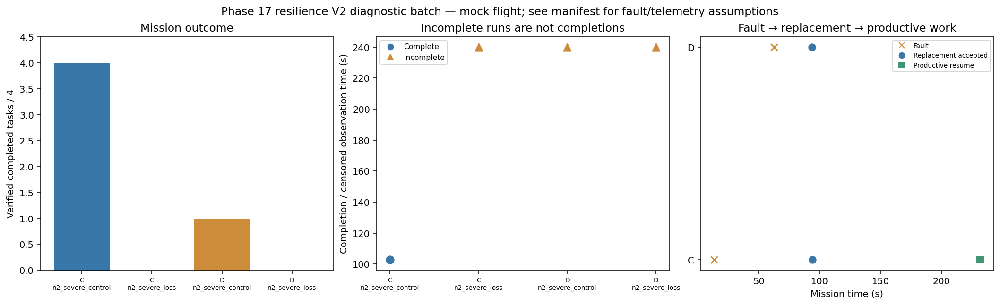

# Phase 17 resilience V2 diagnostic batch

Stage: severe; 4/4 runs; 1 completed missions.
Stored size: 2.83 MiB. Fault trigger: owned_motion. Telemetry: alive.

This is a new declared scenario, not final calibration. Replay is not LLM inference. Successful state-triggered recovery does not validate full radio-loss recovery.

| Case | Completed tasks | Complete | Time (s) | Replacement accepted at (s) | Productive resume at (s) |
|---|---:|---|---:|---:|---:|
| C_n2_severe_control_s7 | 4 | True | 102.80014246201608 | None | None |
| C_n2_severe_loss_s7 | 0 | False | 239.80006415804382 | 94.20009416597895 | 232.00009217101615 |
| D_n2_severe_control_s7 | 1 | False | 239.80128287593834 | None | None |
| D_n2_severe_loss_s7 | 0 | False | 239.80007286102045 | 93.80023730604444 | None |

